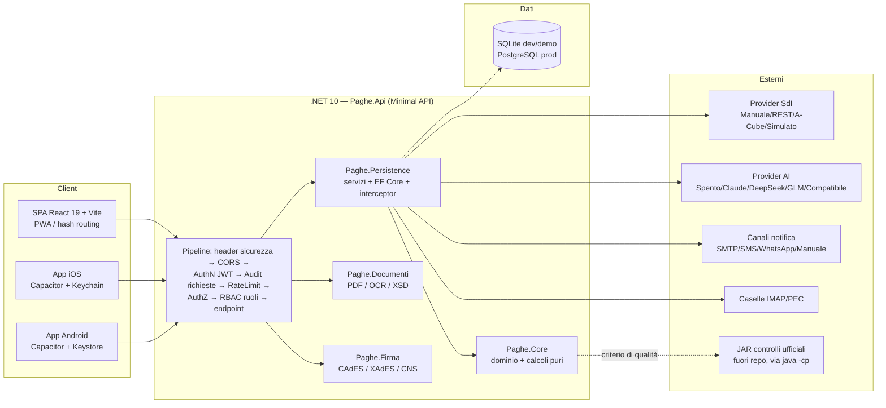
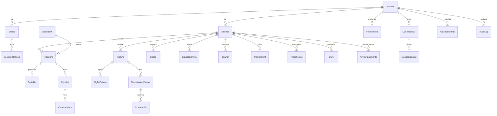

# MASTER PROJECT PLAN — PaghePro

**SaaS italiano per buste paga, fatturazione, contabilità e adempimenti per micro-imprese e studi professionali.**

- **Data documento:** 18 luglio 2026
- **Stato repository al momento dell'analisi:** branch `epic/f3-gdpr-cifratura`; ultima fase completata: Fase 3 GDPR (cifratura + registro attività); suite backend citata nei documenti più recenti: 615/615 verde.
- **Metodo:** questo documento è stato prodotto analizzando l'intero repository (backend, frontend, database, test, documentazione). Ogni affermazione è ancorata a file esistenti. Nulla è inventato: dove una funzione non esiste, è marcata come mancante.
- **Legenda di stato usata in tutto il documento:**
  - ✅ **FATTO** — esiste nel codice, con test
  - ⚠️ **PARZIALE** — esiste ma incompleto o non validato
  - ❌ **MANCANTE** — da costruire (codice nostro)
  - 🔒 **BLOCCATO** — dipende da credenziali esterne, validazione professionale o gate non superato
- **Precedenza documentale:** questo Master Project Plan è la vista d'insieme. Per l'AI applicativa prevale `docs/PIANO-AI-LIBERA-LIMITI-USO.md`; per il piano operativo a caselle prevale `PIANO.md`; per i dettagli di ogni area valgono i documenti citati sezione per sezione.

---

## Indice

0. [Sintesi esecutiva](#0-sintesi-esecutiva)
1. [Visione del prodotto](#1-visione-del-prodotto)
2. [Obiettivi](#2-obiettivi)
3. [Requisiti funzionali](#3-requisiti-funzionali)
4. [Requisiti non funzionali](#4-requisiti-non-funzionali)
5. [Architettura completa](#5-architettura-completa)
6. [Database completo](#6-database-completo)
7. [API complete](#7-api-complete)
8. [Modello dati](#8-modello-dati)
9. [Flussi dell'app](#9-flussi-dellapp)
10. [Tutte le schermate](#10-tutte-le-schermate)
11. [UX/UI](#11-uxui)
12. [Gestione utenti](#12-gestione-utenti)
13. [Ruoli e permessi](#13-ruoli-e-permessi)
14. [Sicurezza](#14-sicurezza)
15. [OCR](#15-ocr)
16. [AI](#16-ai)
17. [Automazioni](#17-automazioni)
18. [Report](#18-report)
19. [Notifiche](#19-notifiche)
20. [Logging](#20-logging)
21. [Backup](#21-backup)
22. [Deploy](#22-deploy)
23. [Piano di test](#23-piano-di-test)
24. [Piano di rilascio](#24-piano-di-rilascio)
25. [Roadmap completa](#25-roadmap-completa)
- [Appendice A — Fonti nel repository](#appendice-a--fonti-nel-repository)
- [Appendice B — Divergenze note da risolvere](#appendice-b--divergenze-note-da-risolvere)

---

## 0. Sintesi esecutiva

PaghePro è un gestionale SaaS multi-tenant che **prepara** buste paga, fatture elettroniche, dichiarazioni e pratiche per micro-imprese italiane; **l'invio** agli enti avviene sempre tramite canali ufficiali (provider accreditati, intermediari abilitati, portali degli enti). Il prodotto è composto da:

- **Backend** .NET 10 (ASP.NET Core Minimal API), 6 progetti: `Paghe.Api` (host + ~150 endpoint), `Paghe.Core` (dominio e calcoli, zero I/O), `Paghe.Persistence` (EF Core SQLite/PostgreSQL + 40 servizi), `Paghe.Documenti` (PDF/OCR/XSD), `Paghe.Firma` (CAdES/XAdES, PFX + CNS), `Paghe.Demo` (console dimostrativa).
- **Frontend** React 19 + TypeScript + Vite, SPA a navigazione hash con ~30 schermate, PWA installabile, design system "skeuo + glass" artigianale, base mobile nativa Capacitor 8 (iOS/Android) con keychain per il refresh token.
- **Sicurezza/GDPR**: JWT v2 da 15 minuti con refresh opaco rotante e revoca sessioni; cifratura AES-256-GCM versionata con AAD tenant/record-bound per IBAN, dati salute, voci cedolino, TOTP e ApiKey; registro attività append-only; modulo retention con policy versionate, legal hold e cancellazioni idempotenti.
- **AI**: spenta di default. Livello di lettura documenti multi-provider dietro seam (`IEstrattoreAiDocumenti`); "Usage Governor" con mandati a tempo, quote, kill-switch e audit a catena hash (pannello **Aurora**). Nessun modello collegato in produzione: i gate di governance (G1 isolamento, G2 completo) non sono chiusi.

**Cosa rende il prodotto già credibile:** motore cedolino lordo→netto con conguaglio e TFR, F24 con tracciato ufficiale **validato dal JAR di controllo AdE (esito positivo)**, FatturaPA con XSD ufficiale e controlli SdI, CU e AA7/10 stampati **sul PDF ufficiale AdE**, UniEmens e autoliquidazione INAIL in bozza, firma digitale reale (motore), ~600 test verdi.

**Cosa manca per vendere:** validazione dei calcoli da un Consulente del Lavoro, migrazioni EF versionate + RLS, retention GDPR completata con documenti legali (DPA/ROPA/DPIA), account provider SdI, controlli ufficiali su UniEmens/CU/LIPE/770, conservazione a norma, pubblicazione mobile, contratto e assicurazione. Il dettaglio è nella sezione 25.

---

## 1. Visione del prodotto

### 1.1 Che cosa è

*(fonte: `docs/commerciale/POSIZIONAMENTO.md`, `docs/commerciale/CATALOGO-SERVIZI.md`, `README.md`)*

> "Il gestionale che **prepara e gestisce** gli adempimenti di paghe, fatture e contabilità per micro-imprese; l'**invio** avviene tramite provider accreditato o canale del professionista."

La visione di lungo periodo è il **one-stop shop**: una piattaforma "tutto in un posto" articolata in 14 Mondi (Conto&Pagamenti, Fatturazione, Contabilità, Tasse, Paghe/HR, Operations, Finanza/Credito, Compliance, BI, AI, Identità/Firma, Pratiche, Marketplace, Verticali), ciascuno marcato 🔨 costruisci / 🤝 partner / 🔗 integra. Il **cuore difendibile** costruito in casa è contabilità + paghe + dichiarazioni; i mondi finanziari passano da partner (nessuna licenza bancaria).

### 1.2 A chi si rivolge

1. **Studi di commercialisti e consulenti del lavoro** (target primario di vendita): gestiscono N aziende clienti da un solo account "studio" (tenant), con più operatori e ruoli.
2. **Micro-imprese** che vogliono un unico strumento per fatturare, pagare i dipendenti e tenere le scadenze, appoggiandosi al proprio professionista per gli invii.

### 1.3 Che cosa NON è (claim vietati)

*(fonte: `docs/commerciale/POSIZIONAMENTO.md`, `docs/commerciale/DISCLAIMER.md`)*

- NON "invia tutto in automatico": nessun bot sui portali AdE/INPS/INAIL/CCIAA, mai simulare login. L'invio reale passa da canali ufficiali (provider accreditato, Entratel/Desktop Telematico, InfoCamere, intermediario).
- NON "sostituisce il commercialista": gli output sono **elaborazioni di supporto** marcate "BOZZA DA VALIDARE" finché un professionista abilitato non le valida.
- NON "calcoli garantiti/certificati": i parametri normativi in seed sono esempi da validare; la certificazione arriva solo con validazione professionale e controlli ufficiali superati.
- L'**AI legge, organizza, spiega e propone; il codice deterministico calcola; la conferma resta umana** (principio non negoziabile, ribadito in tutti i piani AI).

### 1.4 Differenziatori

- **Onestà strutturale**: stati vuoti veri (mai dati finti), etichette bozza, blocchi anti-errore (mesi futuri, pre-assunzione, doppioni CF, F24 inviato protetto).
- **Criterio di qualità "ufficiale"**: un file telematico è considerato corretto solo se supera il **modulo di controllo ufficiale** (JAR SOGEI) con esito positivo — già dimostrato per l'F24.
- **Privacy by design**: cifratura tenant-bound, audit append-only, AI spenta di default con governance a mandati (nessun concorrente della fascia micro offre un "Governatore AI" con kill-switch e registro "Cosa vede l'AI").
- **Prezzo semplice** (bozza `docs/commerciale/LISTINO-PREZZI.md`): canone studio + quota per azienda (Start ~29€+3€, Studio ~79€+2,5€, Pro ~149€+2€ — valori di partenza da confermare).

---

## 2. Obiettivi

### 2.1 Obiettivi di prodotto (da `PIANO.md`)

| Tappa | Obiettivo | Contenuto | Stima |
|---|---|---|---|
| **Tappa A — "MVP vendibile"** | Un professionista può usarlo per fatture + paghe base con invii via provider | Fasi 1→5 del piano: commerciale, fondamenta produzione, GDPR, invio SdI reale, firma | ~3–4 mesi |
| **Tappa B — "come gli altri"** | Paghe complete con adempimenti previdenziali e fiscali controllati ufficialmente | Fasi 6→9: UniEmens/INAIL, controlli AdE (F24/CU/LIPE/770), conservazione, validazione + contratto + assicurazione + lancio | ~9–15 mesi totali |

Costo vivo stimato primo anno (hosting, provider, certificati, consulenze minime): **~500–2.500 €** (fonte `PIANO.md`).

### 2.2 Criteri di successo misurabili

1. **Correttezza ufficiale**: ogni file telematico prodotto supera il rispettivo JAR di controllo con esito positivo (criterio già adottato e superato per F24 Erario+Regioni+IMU).
2. **Correttezza professionale**: cedolini ricalcolati al centesimo contro buste paga reali (golden test in `docs/buste-reali/`; IRPEF già al centesimo, INPS di settore da completare) e validazione formale del Consulente del Lavoro.
3. **Qualità del software**: build 0 errori/0 avvisi, suite backend e frontend verdi a ogni fase (Definition of Done in `AGENTS.md`).
4. **Sicurezza**: isolamento tenant provato da test dedicati; nessun segreto nel repo; avvio fail-closed in produzione senza chiavi robuste.
5. **GDPR**: cifratura + registro + retention operativi E documenti legali validati da professionista privacy — solo allora si può dichiarare conformità (divieto esplicito prima, `docs/COSE-NON-FATTE-PER-SICUREZZA.md` §9).

### 2.3 Non-obiettivi (esclusioni esplicite)

- Nessuna automazione browser/bot su portali pubblici (deliberato, §1 di `COSE-NON-FATTE-PER-SICUREZZA.md`).
- Nessun codice AGPL/GPL dentro il SaaS senza decisione esplicita (`CLAUDE.md`).
- Fuori perimetro MVP paghe (da `README.md`): multi-CCNL completo (~900 contratti), apprendistato, somministrazione, CIG, agricoli speciali, 770 completo.
- Nessuna funzione bancaria diretta (mondi finanziari via partner).
- L'AI non decide mai paghe/imposte e non riceve segreti (chiavi, password, PIN).

---

## 3. Requisiti funzionali

Numerazione RF-per-area. Ogni requisito riporta lo stato reale nel codice.

### RF-A — Account, studio e multi-tenancy
| ID | Requisito | Stato |
|---|---|---|
| RF-A1 | Registrazione self-service di uno studio (tenant) con primo utente admin | ✅ `POST /api/auth/registra` |
| RF-A2 | Login email/password con 2FA TOTP opzionale | ✅ (`AuthService`, `Totp.cs`) |
| RF-A3 | Login con Google (ID token OAuth) | ✅ `POST /api/auth/google` |
| RF-A4 | Sessioni brevi (15 min) con refresh rotante monouso e revoca famiglia | ✅ JWT v2 + `SessioniRefreshService` |
| RF-A5 | Isolamento totale dei dati per tenant su ogni query | ✅ filtro `TenantId` + test `IsolamentoTenantTests` |
| RF-A6 | Sospensione/riattivazione di uno studio da super-admin di piattaforma | ✅ `/api/admin/studi/*` |
| RF-A7 | Spazio demo isolato per browser (account `demo-<uuid>@paghe.local`) | ✅ frontend `auth.tsx` + `POST /api/demo/dataset` |
| RF-A8 | Gestione utenti aggiuntivi dello studio da UI (inviti, ruoli) | ❌ (pannello "Utenti e permessi" è placeholder; ruoli oggi solo via dati) |

### RF-B — Anagrafica aziende (clienti dello studio)
| ID | Requisito | Stato |
|---|---|---|
| RF-B1 | CRUD azienda con anagrafica fiscale/contributiva completa (P.IVA, CF, PEC, SdI, codice catastale, CSC INPS, matricola, PAT INAIL, CCNL default, IBAN, legale rappresentante) | ✅ `AziendeService`, duplicati P.IVA/CF per tenant |
| RF-B2 | Creazione azienda da visura camerale (PDF testuale, foto via OCR, testo incollato) | ✅ `VisuraCameraleParser` + `POST /api/aziende/da-visura` |
| RF-B3 | Modalità "prova contributiva": salvataggio con INPS/INAIL/CCNL mancanti, F24/UniEmens bloccati finché provvisoria | ✅ |
| RF-B4 | Logo aziendale (PNG/JPEG ≤1 MB) stampato in testata cedolino | ✅ |
| RF-B5 | Eliminazione singola e in blocco | ✅ |

### RF-C — Dipendenti, rapporti, presenze
| ID | Requisito | Stato |
|---|---|---|
| RF-C1 | Anagrafica dipendente con CF unico per tenant; riuso anagrafica tra aziende dello stesso tenant | ✅ (regola anti-doppione) |
| RF-C2 | Rapporto di lavoro: CCNL, livello, qualifica, part-time, mensilità, scatti, superminimo, assunzione/cessazione | ✅ |
| RF-C3 | Import UNILAV (XML Comunicazione Obbligatoria e PDF dei portali regionali) → datore+lavoratore+rapporto | ✅ `ImportazioneUnilav`, `/api/unilav/pdf` |
| RF-C4 | Cartellino mensile: straordinari (normale/notturno/festivo), ferie, ROL/ex-festività, malattia con n° evento, infortunio, assenze non retribuite | ✅ pagina Presenze (unico editor delle variabili) |
| RF-C5 | Cartellino **giornaliero** (calendario) come nei gestionali professionali | ❌ 🔴 P0 (`docs/RICERCA-CEDOLINO-PROFESSIONALE-2026.md`) |
| RF-C6 | Anonimizzazione dipendente (diritto all'oblio GDPR) | ✅ `POST /api/dipendenti/{id}/anonimizza` (solo admin) |

### RF-D — Cedolino / paghe
| ID | Requisito | Stato |
|---|---|---|
| RF-D1 | Calcolo lordo→netto: minimi CCNL, scatti, straordinari, INPS, IRPEF a scaglioni, addizionali, detrazioni, 13ª/14ª, TFR, malattia/infortunio con storno paga ordinaria | ✅ `MotoreCalcoloCedolino` + moduli `Calcolo/` |
| RF-D2 | Conguaglio fiscale di dicembre e rivalutazione TFR | ✅ |
| RF-D3 | Archiviazione cedolino con voci, saldi ferie/permessi, costo azienda; PDF A4 tabellare professionale con logo | ✅ `CedoliniService` + `CedolinoPdf` |
| RF-D4 | Regole anti-errore: no mesi futuri, no pre-assunzione, no post-cessazione, mese con F24 inviato protetto (ricalcolo solo forzato), avviso ferie negative | ✅ `BloccaPeriodiFuturi` + test |
| RF-D5 | Regole CCNL tutte versionate per anno su DB (zero valori cablati residui) | ⚠️ 🔴 P0 (alcune regole malattia/infortunio ancora nel codice) |
| RF-D6 | Ciclo di vita bozza→validata→chiusa con snapshot immutabile; codice unico CNEL sul cedolino (obbligo dal 28/6/2026) | ❌ 🔴 P1 |
| RF-D7 | Libro Unico del Lavoro (PDF) | ✅ `LibroUnicoPdf` (da validare) |
| RF-D8 | Validazione dei calcoli da Consulente del Lavoro | 🔒 (attività del fondatore) |

### RF-E — Adempimenti previdenziali e fiscali dalle paghe
| ID | Requisito | Stato |
|---|---|---|
| RF-E1 | F24 dai cedolini (IRPEF, addizionali, INPS) con pratica persistita, macchina a stati ed export | ✅ |
| RF-E2 | Tracciato telematico F24 ufficiale (record A/M/V/Z 1900 char) validato dal controllo ufficiale | ✅ (esito positivo JAR `ControlliF24A0.jar`); ❌ sezione INPS: matricola formato "F" da verificare con matricola reale |
| RF-E3 | Ravvedimento operoso (sanzioni+interessi+righe F24) | ✅ `/api/ravvedimento/calcola` |
| RF-E4 | UniEmens mensile dai cedolini (XML) | ⚠️ bozza; ❌ controllo ufficiale INPS, Qualifica/Giorni/Settimane da affinare |
| RF-E5 | Autoliquidazione INAIL con pratica archiviata e bozza scaricabile | ⚠️ bozza (base imponibile semplificata, no multi-PAT, no tracciato telematico) |
| RF-E6 | Certificazione Unica per percipiente e per azienda, PDF sul modello ufficiale AdE 2026 | ✅ PDF; ❌ file telematico + controllo `ModuliControlloCUR26.jar` |
| RF-E7 | Modello 770 (bozza + export CSV) | ⚠️ bozza; ❌ file telematico |
| RF-E8 | Redditi PF/730 con oneri e acconti; IRAP; IRES; IMU (con immobili); Intrastat | ⚠️ bozze di calcolo; ❌ modelli/file ufficiali |

### RF-F — Fatturazione elettronica e firma
| ID | Requisito | Stato |
|---|---|---|
| RF-F1 | Fattura con righe, IVA, nature; XML FatturaPA; validazione XSD ufficiale (Schema_VFPR12 1.2.3) offline; controlli semantici SdI (00400/00401/00417/00422) | ✅ |
| RF-F2 | Trasmissione a SdI dietro gateway configurabile (Manuale default, REST generico, A-Cube, Simulato); stati RC/MC/NS/NE/DT; ricevute; blocco doppi invii | ✅ infrastruttura; 🔒 account/ApiKey provider reale |
| RF-F3 | Configurazione SdI self-service per tenant (preset provider, verifica credenziali, ApiKey cifrata) | ✅ |
| RF-F4 | Deleghe intermediario (crea/elenca/revoca) | ✅ |
| RF-F5 | Firma digitale CAdES (.p7m) e XAdES (XML) con PFX o CNS/smart card PKCS#11; verifica firma | ✅ motore; 🔒 collaudo con certificato qualificato reale, marche temporali CAdES-T |
| RF-F6 | Webhook ricevute dal provider; conservazione a norma | ❌ / 🔒 |
| RF-F7 | PDF di cortesia fattura | ✅ |

### RF-G — Contabilità, IVA, bilancio
| ID | Requisito | Stato |
|---|---|---|
| RF-G1 | Registrazione spese (IVA acquisti, detraibilità) e liquidazione IVA periodica con registri | ✅ |
| RF-G2 | LIPE trimestrale e riepilogo/dichiarazione IVA annuale (bozza + CSV) | ⚠️ bozze; ❌ file telematico LIPE |
| RF-G3 | Bilancio CEE (SP+CE art. 2424/2425) persistito con stati, precompilazione da fatture/spese/cedolini, PDF | ✅; ❌ XBRL per deposito |
| RF-G4 | Contabilità in partita doppia (piano conti, registrazioni) | ❌ (solo concettuale in `db/schema.sql` storico; `SeedPianoConti` esiste in Core) |

### RF-H — Pratiche e moduli ufficiali
| ID | Requisito | Stato |
|---|---|---|
| RF-H1 | Pratiche ComUnica (apertura/variazione/cessazione P.IVA): piano adempimenti per ente, macchina a stati, distinta, assistente a chat da testo libero | ✅ |
| RF-H2 | Generazione pacchetto ufficiale ComUnica (ZIP+XML+SHA1+firma) e invio web service InfoCamere | ❌ / 🔒 (adesione + utenza Telemaco) |
| RF-H3 | Archivio persone fisiche riusabile (rappresentanti/soci) | ✅ |
| RF-H4 | Modello AA7/10 compilato sul PDF ufficiale AdE con tabelle natura giuridica/cariche | ✅; ❌ file telematico AA7/AA9 (piano in `docs/integrazione-ufficiale/PIANO-AA7-AA9-TELEMATICO.md`) |

### RF-I — Scadenzario, pagamenti, posta
| ID | Requisito | Stato |
|---|---|---|
| RF-I1 | Scadenzario con DURC (scadenza a 120 gg), promemoria auto-generati da DURC e F24, testo messaggio precompilato, stati preservati | ✅ |
| RF-I2 | Upload DURC PDF con controllo P.IVA/azienda | ✅ |
| RF-I3 | Avvisi di pagamento clienti (mensili, promemoria/solleciti, stati) | ✅ |
| RF-I4 | Posta email/PEC via IMAP self-service: sincronizzazione, lettura, triage urgente/pubblicità **proposto dall'AI e confermato dall'utente** | ✅ |
| RF-I5 | Invio promemoria multi-canale (Email SMTP, SMS, WhatsApp, Manuale default) | ✅ codice; 🔒 credenziali reali dei canali |

### RF-J — AI applicativa
| ID | Requisito | Stato |
|---|---|---|
| RF-J1 | Lettura documenti multi-provider dietro seam, default Spento, l'euristica deterministica vince, l'AI riempie solo campi vuoti sopra soglia confidenza | ✅ |
| RF-J2 | "AI inclusa nel canone": chiave centrale, contatore consumi per studio/mese con limite | ✅ `ConsumoAiService` |
| RF-J3 | Usage Governor: mandati a tempo con quote, preflight, revoca, kill-switch "Arresta", audit a catena hash, "Cosa vede l'AI" | ✅ nucleo (G2 non chiuso) |
| RF-J4 | Assistente Aurora con controlli deterministici read-only (scadenze, cedolini incompleti, anagrafiche incomplete) | ✅ |
| RF-J5 | Collegamento di un modello AI reale ai flussi con dati reali | 🔒 vietato fino a chiusura gate G1 (isolamento) e validazioni GDPR |

### RF-K — GDPR operativo
| ID | Requisito | Stato |
|---|---|---|
| RF-K1 | Cifratura dati sensibili a riposo con rotazione chiavi e cutover atomico | ✅ |
| RF-K2 | Registro attività (accessi + modifiche) consultabile da admin con filtri | ✅ |
| RF-K3 | Retention: policy per categoria versionate, legal hold, anteprima vincolante, esecuzione idempotente con ricevuta a catena digest | ✅ endpoint `/api/retention/*` (costruito nella fase corrente; da completare verifica e documenti organizzativi) |
| RF-K4 | Diritto all'oblio (anonimizzazione dipendente) | ✅ |
| RF-K5 | Privacy policy, DPA, ROPA, informative, DPIA, procedure data breach | 🔒 (professionista privacy + fondatore) |

---

## 4. Requisiti non funzionali

### RNF-1 — Correttezza numerica
- **Solo `decimal`** per importi e aliquote, mai `float`/`double` (regola invariabile, `CLAUDE.md`).
- Precisioni EF: importi `(15,2)`, aliquote `(8,5)`, tassi INAIL `(8,3)`, parametri `(12,5)`.
- Arrotondamenti centralizzati (`Arrotondamento.cs`).

### RNF-2 — Parametri normativi versionati
- Aliquote, scaglioni, addizionali, CCNL sono **dati per anno su DB** (mai modificare righe storiche: si inseriscono nuove righe; i cedolini passati restano ricalcolabili). Vietato reintrodurre valori cablati nel calcolo.
- `Seed.cs` contiene solo valori d'esempio per inizializzare; il dataset CCNL ufficiale (fonti CNEL) li sovrascrive all'avvio.

### RNF-3 — Multi-tenancy
- Ogni query persistita filtra per `TenantId` (dal claim JWT `tenant_id`, mai da header).
- Vincoli unici per-tenant; indici prefissati da `TenantId`.
- Cifratura tenant-bound (AAD): un ciphertext non è decifrabile in un altro tenant.
- Target futuro: RLS PostgreSQL come difesa strutturale (oggi solo applicativa) — vedi §14.

### RNF-4 — Sicurezza fail-closed
- In Production l'app **rifiuta di partire** con `Jwt:Key` di sviluppo o < 32 byte e con `PAGHE_DATA_KEY` non valida (sentinella su DB).
- Backup cifrati fail-closed (senza recipient `age` lo script si ferma).
- Endpoint sensibili con rate limit; upload con limiti e riconoscimento dal contenuto.

### RNF-5 — Auditabilità
- Audit append-only a livello applicativo (blocco Update/Delete via interceptor); mai valori sensibili nel log (solo nomi semantici dei campi); UTC; correlation ID.
- Catene hash tamper-evident per audit AI e ricevute retention.

### RNF-6 — Disponibilità e capacità (target attuale)
- Deploy a **replica singola** con SQLite su volume o PostgreSQL gestito (Supabase); nessun requisito HA dichiarato per la fase attuale.
- Health check `/health` per orchestratori.
- Scala prevista: studi con decine di aziende clienti e centinaia di cedolini/mese per tenant (micro-imprese); nessun requisito di carico formalizzato — da definire prima della Tappa B.

### RNF-7 — Compatibilità e piattaforme
- Browser evergreen desktop/mobile; PWA installabile; app native iOS/Android via Capacitor (gate HTTPS).
- Database: SQLite (sviluppo/demo) e PostgreSQL (produzione) con selezione automatica dal connection string.
- La firma CNS richiede middleware PKCS#11 + carta sulla macchina che firma (desktop/agente locale, non il backend cloud).

### RNF-8 — Accessibilità e lingua
- Interfaccia interamente in **italiano** (anche codice e messaggi).
- `prefers-reduced-motion` rispettato; focus visibile; ARIA sulle superfici interattive; fallback opaco senza `backdrop-filter`.
- Dark mode: assente per scelta corrente (`color-scheme: light`).

### RNF-9 — Manutenibilità
- Dominio (`Paghe.Core`) senza I/O, testabile puro; seam espliciti per AI, SdI, firma, notifiche (typed HttpClient testabili con handler finti).
- Stile "modifiche chirurgiche": ogni riga riconducibile a una richiesta; niente flessibilità speculativa (linee guida Karpathy in `CLAUDE.md`).

### RNF-10 — Vincoli legali/licenze
- Nessuna dipendenza AGPL/GPL (PDFsharp MIT, Pkcs11Interop Apache-2.0, PdfPig, Tesseract wrapper verificati in `docs/GITHUB_REPOS_RIUSO.md`).
- Asset ufficiali (JAR, XSD, WSDL, modelli PDF AdE) fuori dal repo pubblico, nel kit locale `~/ade-official-integration-kit/`.

---

## 5. Architettura completa

### 5.1 Vista d'insieme



### 5.2 Progetti backend e responsabilità

| Progetto | Responsabilità | Regola architetturale |
|---|---|---|
| `Paghe.Api` | Host web, ~150 endpoint Minimal API, pipeline middleware, DI, bootstrap schema/seed, CLI GDPR (`--migra-dati-sensibili`, `--verifica-dati-sensibili`) | Nessuna logica di dominio negli endpoint: delega ai servizi |
| `Paghe.Core` | Dominio e calcoli (Calcolo cedolino, Fatturazione, Contabilità, AdeTelematico, PartiteIva, Notifiche, Parametri, Scadenzario, Ai) | **Zero I/O**, zero dipendenze da EF; tutto testabile puro |
| `Paghe.Persistence` | 40 servizi applicativi, `PagheDbContext`, entità, Gdpr/ (cifratura+audit+retention), Sicurezza/ (RBAC, sessioni, TOTP), Ai/ (governor), Trasmissione/ (gateway SdI) | Ogni query filtra per `TenantId` |
| `Paghe.Documenti` | PDF (cedolino, fattura, bilancio, LUL, CU ufficiale, AA7/10 ufficiale con overlay), estrazione testo PDF, OCR Tesseract, validazione XSD FatturaPA | Modelli ufficiali AdE incorporati come risorse |
| `Paghe.Firma` | `MotoreFirma` (CAdES/XAdES), firmatari `FirmatorePfx`/`FirmatoreCns` (PKCS#11) | Nessuna dipendenza GPL; chiave mai fuori dalla carta |
| `Paghe.Demo` | Console dimostrativa (cedolini su dati seed) | Nessun accesso a DB reale |

### 5.3 Seam (punti di estensione) — dove NON si decide due volte

| Seam | Interfaccia | Implementazioni esistenti | Selezione |
|---|---|---|---|
| Lettura AI documenti | `IEstrattoreAiDocumenti` | `EstrattoreAiSpento` (default), `EstrattoreAiAnthropic`, `EstrattoreAiCompatibile` (DeepSeek/GLM/Ollama/OpenAI-like) | config `Ai:Provider` |
| Gateway SdI | `IFatturaSdiGateway` | `SdiGatewayManuale` (default), `SdiGatewayProviderRest`, `SdiGatewayAcube`, `SdiGatewaySimulato` | config `Sdi:Provider` + `ConfigurazioneSdiEntity` per tenant |
| Firma fattura | `IFirmaFatturaElettronica` | `FirmaCadesLocale`, firma delegata al provider | config `Sdi:FirmaLocale` |
| Firmatario | `IFirmatoreDigitale` | `FirmatorePfx`, `FirmatoreCns` | per richiesta (upload PFX o PIN CNS) |
| Notifiche | `INotificatore` | `NotificatoreManuale` (default), Email SMTP, SMS, WhatsApp | config `Notifiche:Canale` |
| Orologio | `TimeProvider` | sistema; `OrologioFisso` nei test | DI |

### 5.4 Pattern telematico obbligatorio

Per ogni adempimento verso un ente il flusso è sempre:
**genera → valida (controlli interni) → controllo ufficiale (JAR/web service SOGEI-ente) → firma → invia via canale ufficiale → traccia stati/ricevute.**
Mai saltare il controllo ufficiale; mai automatizzare portali. I wrapper JAR girano con `java -cp` (`ControlliUfficiali.cs`), gli asset restano fuori dal repo.

### 5.5 Gestione dello schema database

- **Oggi**: `EnsureCreated()` + `EnsureSchemaSviluppoCompatibile()` (DDL idempotente SQLite) + DDL Postgres espliciti in `Program.cs` + `AllineaColonneMancanti()` (rete di sicurezza generica: aggiunge colonne EF mancanti con default neutri) + `AiGovernorSchema`/`SessioniRefreshSchema` + runner GDPR one-shot.
- **Target dichiarato** (Fase 2 / F2): **migrazioni EF versionate** con rollback provato, da generare quando lo schema è stabile (`PagheDbContextFactory` già pronta, `dotnet ef` funzionante). Fino ad allora nessun dato reale in produzione.

### 5.6 Frontend

- SPA **senza router library**: navigazione hash-based (`#sezione`) gestita in `Dashboard.tsx` (shell unica) con chiavi tipizzate (`SectionKey`); `react-router-dom` è in package.json ma non usato (da rimuovere — vedi Appendice B).
- Client API tipizzato unico (`src/api.ts`, ~1200 righe) con refresh automatico su 401, download via blob/share-sheet.
- Stato: nessuna libreria di stato globale; contesto Auth + storage namespacato per tenant (`chiaveStorageTenant`).
- Build separate: web (`npm run build`), mobile (`mobile:build` con gate HTTPS/appId), vetrina (`VITE_VETRINA=1`).

### 5.7 Decisioni architetturali fissate (ADR sintetici)

1. **Minimal API monolitica** (no microservizi): dominio coeso, un solo deploy, complessità operativa minima per il target micro.
2. **EF Core con provider dual SQLite/Postgres** rilevato dal connection string; forzabile con `Database:Provider`.
3. **Cifratura applicativa** (non TDE): envelope `enc:v2:<idChiave>:...` con AAD, perché deve sopravvivere a DB gestiti terzi e legare i dati al tenant.
4. **Audit come interceptor EF** nella stessa transazione del salvataggio (mai log disallineato dai dati).
5. **Refresh token opaco selector+secret** (hash-only nel DB), non JWT: revocabilità reale.
6. **Frontend CSS artigianale a token** (no Tailwind): controllo totale del design system skeuo+glass.
7. **AI dietro seam con default Spento**: il prodotto è completo senza AI; ogni capacità AI nasce NEGATA e passa dal Governor.

---

## 6. Database completo

> Fonte autorevole: modello EF in `backend/src/Paghe.Persistence/PagheDbContext.cs`. Il file `db/schema.sql` è un **archivio storico non eseguibile** (bloccato con `\quit` in testa): non usarlo.

### 6.1 Tabelle (44 DbSet + figlie + tecniche)

**Piattaforma e sicurezza**
| Tabella | Contenuto | Vincoli chiave |
|---|---|---|
| `Tenants` | Studi/account (RagioneSociale, Sospeso) | — |
| `Utenti` | Utenti con ruolo, PBKDF2, 2FA (`SegretoTotp` cifrato) | UNIQUE `Email` globale |
| `SessioniRefresh` | Refresh token rotanti (hash-only, famiglie `sid`, replay detection) | UNIQUE `(TenantId,Id)`; concurrency `Versione` |
| `AuditLog` | Registro GDPR append-only (accessi + modifiche, solo nomi campi) | idx `(TenantId,QuandoUtc)`, `(TenantId,Entita)` |
| `MetadatiProtezioneDati` | Tabella tecnica (fuori EF): sentinella chiave dati | gestita dal runner GDPR |

**Anagrafiche e lavoro**
| Tabella | Contenuto | Vincoli chiave |
|---|---|---|
| `Aziende` | Datori di lavoro completi; `IbanProtetto` cifrato; `Logo` | idx `(TenantId,CodiceFiscale)` |
| `Dipendenti` | Persone assunte; `IbanProtetto`; `Anonimizzato` | UNIQUE `(TenantId,CodiceFiscale)` |
| `Rapporti` | Inquadramento completo, assunzione/cessazione, TFR iniziale | idx `(TenantId,AziendaId)` |
| `Cartellini` | Presenze mensili; terna salute in `DatiSaluteProtetti` (cifrata) | UNIQUE `(TenantId,RapportoLavoroId,Anno,Mese)` |
| `Cedolini` | Testate buste paga (totali, saldi, conguaglio) | UNIQUE `(TenantId,RapportoLavoroId,Anno,Mese)` |
| `CedolinoVoceEntity` | Righe cedolino interamente cifrate (`DatiVoceProtetti`) | idx `(TenantId,CedolinoId)` |
| `Persone` | Archivio persone fisiche per moduli | UNIQUE `(TenantId,CodiceFiscale)` |

**Fatturazione e contabilità**
| Tabella | Contenuto | Vincoli chiave |
|---|---|---|
| `Fatture` + `RigaFatturaEntity` | Fatture attive con righe | UNIQUE `(TenantId,AziendaId,Anno,Numero)` |
| `Spese` | Fatture passive/registro acquisti | idx `(TenantId,AziendaId,Data)` |
| `LiquidazioniIva` + righe | Liquidazioni periodiche con registri | idx `(TenantId,AziendaId,Dal,Al)` |
| `Bilanci` + `RigheBilancio` | Bilanci CEE con stati e JSON | idx `(TenantId,AziendaId,Anno)` |
| `TrasmissioniFatture` + `RicevuteSdi` | Invii SdI e ricevute RC/MC/NS/NE/DT | idx `(TenantId,AziendaId)`, `FatturaId` |
| `Deleghe` | Deleghe intermediario | idx `(TenantId,AziendaId,TipoAdempimento)` |
| `ConfigurazioniSdi` | Config canale SdI per tenant (`ApiKey` cifrata) | UNIQUE `(TenantId)` |

**Adempimenti**
| Tabella | Contenuto | Vincoli chiave |
|---|---|---|
| `PraticheF24` | Pratiche F24 con `TracciatoUfficiale` e stati | idx `(TenantId,AziendaId,Anno,Mese)` |
| `PraticheInail` / `PosizioniInail` | Autoliquidazioni e PAT | UNIQUE posizione `(TenantId,AziendaId,Anno)` |
| `PraticheAperturaPartitaIva` + `AdempimentoPraticaEntity` | Pratiche ComUnica con adempimenti per ente | idx `(TenantId,CodiceFiscale)` |
| `DichiarazioniRedditiPf` | Input manuali 730/Redditi PF | UNIQUE `(TenantId,RapportoLavoroId,Anno)` |
| `Immobili` | Anagrafica IMU | idx `(TenantId,AziendaId)` |

**Scadenze, pagamenti, posta**
| Tabella | Contenuto | Vincoli chiave |
|---|---|---|
| `Durc` | DURC registrati | idx `(TenantId,AziendaId,DataScadenza)` |
| `Promemoria` | Promemoria idempotenti (Tipo+RiferimentoId) con stati | idx `(TenantId,Tipo,RiferimentoId)` |
| `AvvisiPagamento` | Avvisi mensili clienti (`IbanProtetto`) | UNIQUE `(TenantId,AziendaId,Anno,Mese)` |
| `CaselleEmail` | Caselle IMAP/PEC (`Password` cifrata) | idx `(TenantId,Attiva)` |
| `MessaggiEmail` | Messaggi (anteprima in chiaro, `Corpo` cifrato, triage proposto/confermato) | UNIQUE `(CasellaId,UidImap)` |

**GDPR retention**
| Tabella | Contenuto |
|---|---|
| `PolicyRetention` | Policy per categoria, versionate append-only (UNIQUE `(TenantId,Categoria,Versione)`) |
| `BlocchiConservazione` | Legal hold per categoria |
| `AnteprimeRetention` | Snapshot vincolanti dei candidati (impronte, scadenza) |
| `EsecuzioniRetention` | Ricevute append-only con catena digest (UNIQUE `(TenantId,ChiaveIdempotenza)`) |

**AI**
| Tabella | Contenuto |
|---|---|
| `AiScopeGrants` | Mandati d'uso (scope, quote letture, scadenze, stato; concurrency `Versione`) |
| `AiAudit` | Audit AI append-only con catena hash SHA-256 (UNIQUE `(TenantId,Sequenza)`) |
| `ConsumiAi` | Contatore mensile chiamate per tenant (UNIQUE `(TenantId,Anno,Mese)`) |

**Parametri normativi (senza TenantId — dati condivisi)**
| Tabella | Contenuto |
|---|---|
| `ParametriAnno` (PK `Anno`) | Divisore orario, maggiorazioni straordinario, parametri TFR, ISTAT |
| `InpsAliquote` | Aliquote per `(Anno,Qualifica)` UNIQUE |
| `IrpefScaglioni` | Scaglioni per `(Anno,DaImporto)` UNIQUE |
| `AddizionaliRegionali` / `AddizionaliComunali` | Aliquote per `(Anno,Regione)` / `(Anno,CodiceCatastale)` UNIQUE (regimi a scaglioni MEF sovrapposti a runtime) |
| `Ccnl` (PK `Codice`) + `CcnlLivelli` | Contratti e minimi per `(CcnlCodice,Anno,Livello)` UNIQUE |

### 6.2 Regole trasversali del DB

1. **Cifratura a riposo** (mappa completa in §8.3): mai colonne sensibili in chiaro; le colonne legacy sono state **droppate** dal runner GDPR nel cutover.
2. **DeleteBehavior**: cascade sui figli; `SetNull` su `Promemoria.AziendaId`; `Restrict` sull'auto-FK delle sessioni.
3. **Interceptor sempre attivi**: `ProtezioneDatiInterceptor` (cifra/decifra) PRIMA di `AuditSaveChangesInterceptor` (audita) — l'ordine è vincolante.
4. **Append-only enforced** dall'interceptor per `AuditLog`, `AiAudit`, `PolicyRetention`, `EsecuzioniRetention`.

### 6.3 Lavori mancanti sul database

- ❌ **Migrazioni EF versionate** (sostituire `EnsureCreated` + patch; snapshot alla stabilizzazione dello schema) — prerequisito dati reali.
- ❌ **Row-Level Security PostgreSQL** (esempio commentato in `db/schema.sql`; oggi isolamento solo applicativo).
- ❌ Consolidare il DDL duplicato (versione SQLite in `EnsureSchemaSviluppoCompatibile` vs Postgres in `Program.cs`) dentro le migrazioni.
- ❌ Tabelle previste dal modello concettuale storico e mai realizzate (valutare se servono): `sede_lavoro`, `familiare_carico` (detrazioni familiari), catalogo `voce_paga`, `tfr_movimento`, partita doppia (`piano_conti`, `registrazione_contabile`), `documento` (archivio file).

---

## 7. API complete

Convenzioni globali:
- **Autenticazione**: tutti gli endpoint sono nel gruppo `secured` (JWT obbligatorio) salvo quelli marcati *Anonimo*. Il tenant deriva SEMPRE dal claim `tenant_id`.
- **Rate limiting**: policy `auth` = 10 richieste/min per IP (endpoint di autenticazione); policy `sensibili` = 30/min per utente (firma, upload, retention, AI, sync posta). Risposta 429.
- **RBAC** (middleware centrale, §13): `sola_lettura` solo GET/HEAD/OPTIONS; `/api/audit` e `/api/retention` solo admin/superadmin; `/api/admin/*` solo superadmin; caselle posta e anonimizzazione solo admin.
- **Errori**: 400 con `{errori:[...]}` per validazione; 401/403 JSON neutri; 404 JSON dal catch-all `/api/{**percorso}`; messaggi crittografici mai esposti (solo TraceId nei log).

### 7.1 Autenticazione e sessioni (Anonimi, rate-limit `auth`)
`POST /api/auth/registra` · `POST /api/auth/login` (2FA se attiva) · `POST /api/auth/refresh` · `POST /api/auth/logout` · `POST /api/auth/google` · varianti mobile: `POST /api/auth/mobile/{registra|login|refresh|logout}` (refresh nel body per il keychain, non nel cookie).

### 7.2 Due fattori (autenticati, rate-limit `auth`)
`POST /api/auth/2fa/inizia` · `POST /api/auth/2fa/attiva` · `POST /api/auth/2fa/disattiva`.

### 7.3 Admin piattaforma (superadmin)
`POST /api/admin/bootstrap-superadmin` (one-shot con `SuperAdmin:BootstrapToken`) · `GET /api/admin/studi` · `POST /api/admin/studi/{id}/sospendi` · `POST /api/admin/studi/{id}/riattiva`.

### 7.4 Aziende
`POST/GET /api/aziende` · `GET/PATCH/DELETE /api/aziende/{id}` · `POST /api/aziende/elimina-bulk` · `POST /api/aziende/da-visura` (PDF/foto/testo) · logo: `POST` (rate `sensibili`) `/GET/DELETE /api/aziende/{id}/logo`.

### 7.5 Dipendenti e rapporti
`POST/GET /api/aziende/{aziendaId}/dipendenti` · `POST /api/aziende/{aziendaId}/dipendenti/da-unilav` · `POST /api/unilav/pdf` · `POST /api/dipendenti/{id}/anonimizza` (admin) · `GET/PATCH /api/rapporti/{rapportoId}` · `GET /api/rapporti/{rapportoId}/conguaglio` · `GET /api/rapporti/{rapportoId}/tfr/rivalutazione` · `GET /api/aziende/{aziendaId}/presenze/{anno}/{mese}`.

### 7.6 Cedolini
`POST /api/cedolini/calcola` (stateless) · `POST /api/cedolini/pdf` · `POST /api/rapporti/{rapportoId}/cedolini` (archivia, `?forza=true` per mesi protetti) · `GET /api/rapporti/{rapportoId}/cedolini` · `GET /api/cedolini/{id}` · `GET /api/cedolini/{id}/pdf`.

### 7.7 F24 e ravvedimento
`POST /api/f24/da-paghe` · `POST /api/aziende/{aziendaId}/f24/mese` · `POST /api/aziende/{aziendaId}/f24/mese/salva` · `GET /api/aziende/{aziendaId}/f24` · `GET /api/f24/{id}` · `POST /api/f24/{id}/stato` · `POST /api/f24/{id}/esporta` (tracciato ufficiale) · `POST /api/ravvedimento/calcola`.

### 7.8 Fatturazione elettronica
Stateless: `POST /api/fatture/{calcola|xml|valida|pdf}` · `POST /api/fatture/firma` (rate `sensibili`).
Persistite: `POST/GET /api/aziende/{aziendaId}/fatture` · `GET /api/fatture/{id}` · `GET /api/fatture/{id}/{pdf|xml}` · `POST /api/fatture/{id}/trasmetti` · `GET /api/fatture/{id}/trasmissione`.
Trasmissioni: `GET /api/trasmissioni` · `GET /api/trasmissioni/{id}` · `POST /api/trasmissioni/{id}/ricevute` · `POST /api/trasmissioni/{id}/aggiorna-esito`.
Deleghe: `POST/GET /api/deleghe` · `POST /api/deleghe/{id}/revoca`.
Config: `GET/PUT /api/configurazione-sdi` · `POST /api/configurazione-sdi/verifica`.

### 7.9 Firma digitale
`POST /api/firma/cades` (formato `cades|xades`, PFX o CNS; rate `sensibili`; limiti upload: documento 10 MB, PFX 1 MB) · `POST /api/firma/verifica` (15 MB; rate `sensibili`).

### 7.10 Contabilità IVA e bilancio
`POST /api/contabilita/iva/liquidazione` · `POST/GET /api/aziende/{aziendaId}/spese` · `GET /api/spese/{id}` · `POST/GET /api/aziende/{aziendaId}/liquidazioni-iva` · `GET /api/liquidazioni-iva/{id}` · `GET /api/aziende/{aziendaId}/iva/dichiarazione-annuale/{anno}[/export.csv]` · `GET /api/aziende/{aziendaId}/lipe/{anno}/{trimestre}` · `GET /api/aziende/{aziendaId}/iva-annuale/{anno}` · `POST /api/bilancio/riclassifica` · `POST /api/aziende/{aziendaId}/bilanci[/esempio]` · `GET /api/aziende/{aziendaId}/bilanci[/precompila?anno=]` · `GET /api/bilanci/{id}[/pdf]` · `POST /api/bilanci/{id}/stato`.

### 7.11 Dichiarazioni e imposte
CU: `GET /api/rapporti/{rapportoId}/cu/{anno}[/pdf]` · `GET /api/aziende/{aziendaId}/cu/{anno}[/export.csv]`.
770: `GET /api/aziende/{aziendaId}/modello770/{anno}[/export.csv]`.
Redditi PF: `GET/PUT /api/rapporti/{rapportoId}/redditi-pf/{anno}`.
IRAP/IRES/Intrastat: `GET /api/aziende/{aziendaId}/{irap|ires|intrastat}/{anno}`.
IMU: `GET/POST /api/aziende/{aziendaId}/immobili` · `DELETE /api/immobili/{id}` · `GET /api/aziende/{aziendaId}/imu/{anno}`.

### 7.12 UniEmens e INAIL
`POST /api/aziende/{aziendaId}/uniemens/mese` · `GET/POST /api/aziende/{aziendaId}/inail/posizione` · `GET /api/aziende/{aziendaId}/inail/autoliquidazione` · `POST .../autoliquidazione/salva` · `GET .../autoliquidazioni` · `GET /api/inail/{id}[/bozza]` · `POST /api/inail/{id}/stato`.

### 7.13 Pratiche ComUnica e moduli
`POST /api/pratiche/apertura-partita-iva[/simula|/analizza-testo]` · `GET /api/pratiche/apertura-partita-iva[/{id}][/{id}/distinta]` · `PATCH .../{praticaId}/adempimenti/{adempimentoId}` · `POST .../{id}/stato`.
Persone: `GET/POST /api/persone` · `PUT/DELETE /api/persone/{id}`.
AA7/10: `GET /api/moduli/aa7-10/tabelle` · `POST /api/moduli/aa7-10/pdf`.

### 7.14 Scadenzario, DURC, avvisi di pagamento
`GET/POST /api/scadenzario` · `POST /api/scadenzario/{rigenera|rigenera-calendario|invia-automatiche}` · `GET /api/scadenzario/{id}` · `POST /api/scadenzario/{id}/{stato|invia}` · `POST/GET /api/aziende/{aziendaId}/durc` · `POST /api/documenti-scadenze` (upload DURC PDF).
Avvisi: `POST/GET /api/aziende/{aziendaId}/avvisi-pagamento` · `GET /api/avvisi-pagamento[/promemoria]` · `POST /api/avvisi-pagamento/mese` · `GET /api/avvisi-pagamento/{id}/avviso` · `POST /api/avvisi-pagamento/{id}/{promemoria|stato}`.

### 7.15 Posta
`GET /api/posta/caselle` · `POST/DELETE /api/posta/caselle[/{id}]` (admin) · `POST /api/posta/caselle/{id}/sincronizza` (rate `sensibili`) · `GET /api/posta/messaggi` · `GET /api/posta/messaggi/{id}/corpo` · `POST /api/posta/messaggi/{id}/{letto|conferma}` · `POST /api/posta/messaggi/{id}/proponi-ai` (rate `sensibili`).

### 7.16 AI e Governor
`GET /api/ai/stato` · `POST /api/ai/prova`.
Governor (`/api/ai/governor/*`): `GET catalogo` · `POST preflight` · `POST/GET grants` · `GET grants/{id}` · `POST grants/{id}/revoca` · `POST arresta` (kill-switch) · `POST query` · `POST accesso` · `GET audit/verifica` (integrità catena hash).

### 7.17 GDPR (admin/superadmin, rate `sensibili`)
`GET /api/audit` (registro attività) · `GET /api/retention` · `PUT /api/retention/{categoria}` · `POST /api/retention/{categoria}/anteprima` · `GET/POST /api/retention/blocchi` · `POST /api/retention/blocchi/{id}/revoca` · `GET /api/retention/esecuzioni` · `POST /api/retention/esegui`.

### 7.18 CCNL, demo, sistema
`GET /api/ccnl/{codice}/livelli?anno=` (**Anonimo**) · `GET /api/ccnl` · `POST /api/ccnl/importa` (superadmin) · `POST /api/demo/dataset` · `GET /` o `/api` (indice, Anonimo) · `GET /health` (Anonimo) · `GET /swagger` (solo Development o `Swagger:Abilitato=true`).

### 7.19 API mancanti (da costruire)
- ❌ Gestione utenti dello studio (inviti, cambio ruolo, disattivazione) — oggi nessun endpoint.
- ❌ Cambio password / recupero password.
- ❌ Cancellazione account/studio self-service (gate store mobile).
- ❌ Webhook ricevute SdI (endpoint pubblico firmato dal provider).
- ❌ Export dati interessato (portabilità GDPR art. 20).

---

## 8. Modello dati

### 8.1 Convenzioni

- PK `Guid Id` (eccezioni a chiave naturale: `ParametriAnno.Anno`, `Ccnl.Codice`).
- Quasi tutte le entità di business hanno `Guid TenantId`; le figlie senza `TenantId` (righe fattura/bilancio/liquidazione, ricevute, adempimenti) ereditano l'isolamento dalla testata. Eccezione voluta: `CedolinoVoceEntity` ha un proprio `TenantId` (necessario all'AAD della cifratura, backfillato nel cutover).
- Date `DateOnly`/`DateTime` UTC; importi `decimal`.
- I campi cifrati sono `[NotMapped]` nel dominio e persistiti come envelope stringa `enc:v2:<idChiave>:BASE64(nonce|tag|cifrato)`.

### 8.2 Diagramma delle relazioni principali



### 8.3 Mappa completa dei dati protetti

| Dato | Entità | Colonna DB | Meccanismo |
|---|---|---|---|
| IBAN azienda / dipendente / avviso | `AziendaEntity`, `DipendenteEntity`, `AvvisoPagamentoEntity` | `IbanProtetto` | AES-256-GCM + AAD `versione\|tenant\|tabella\|record\|campo` |
| Terna salute (gg malattia, n° evento, gg infortunio) | `CartellinoEntity` | `DatiSaluteProtetti` | AES-GCM + AAD, payload binario fisso 36 B |
| Voce cedolino (codice, descrizione, tipo, quantità, base, importo) | `CedolinoVoceEntity` | `DatiVoceProtetti` | AES-GCM + AAD, JSON in payload fisso 2048 B |
| Segreto TOTP | `UtenteEntity` | `SegretoTotp` | ValueConverter EF (`ProtettoreDati.ConverterStringa`) |
| ApiKey provider SdI | `ConfigurazioneSdiEntity` | `ApiKey` | ValueConverter EF |
| Password casella IMAP | `CasellaEmailEntity` | `Password` | ValueConverter EF |
| Corpo messaggio email | `MessaggioEmailEntity` | `Corpo` | ValueConverter EF |
| Segreto refresh token | `SessioneRefreshEntity` | `HashSegreto` | Solo hash (mai il valore) |
| Password utente | `UtenteEntity` | `PasswordHash` | PBKDF2 + salt (mai il valore) |

Regole: chiave da `PAGHE_DATA_KEY` (Base64 32 byte; fail-closed in produzione); rotazione con `PAGHE_DATA_OLD_KEYS_JSON` (decrypt-only) + runner `--migra-dati-sensibili`; sentinella `MetadatiProtezioneDati` verificata a ogni avvio; minimizzazione (mai diagnosi, solo giorni/evento).

### 8.4 Macchine a stati persistite

| Oggetto | Stati |
|---|---|
| Pratica ComUnica | Bozza → Pronta → Presentata → Protocollata → Evasa / Scartata / Annullata |
| Pratica F24 | Generata → … → InviataManualmente / RicevutaAcquisita (mese protetto da ricalcolo) |
| Bilancio | Bozza → Approvato → Depositato / Annullato |
| Trasmissione SdI | DaInviare → Inviata → stati ricevuta RC/MC/NS/NE/DT |
| Promemoria | Aperto → Inviato → Completato / Annullato (finali bloccati; rigenerazione idempotente non li tocca) |
| Avviso pagamento | DaPagare → Pagato / Annullato |
| Grant AI | Attivo → Scaduto / Revocato (kill-switch globale) |
| Policy retention | versioni append-only; Attiva/Approvata come flag |

---

## 9. Flussi dell'app

### 9.1 Onboarding studio e sessione

1. Registrazione (`/api/auth/registra`) → crea `Tenant` + primo utente admin → JWT 15 min + refresh (cookie HttpOnly sul web; keychain nativo su mobile).
2. Login: email/password → se `DueFattoriAttivo`, il server risponde `serveCodice2fa` e la UI chiede il codice TOTP → token.
3. Rinnovo: `fetchAutenticata` rinnova il token in scadenza (margine 45 s); multi-scheda coordinato con `navigator.locks` ("paghepro-refresh") per non bruciare il refresh monouso; replay → revoca famiglia.
4. Logout: revoca server-side della famiglia sessione; flag `USCITA_ESPLICITA` evita il rientro demo automatico.

### 9.2 Home studio "azienda-prima" (flusso obbligatorio)

1. All'accesso NESSUNA azienda è selezionata automaticamente (`scegliAziendaPreferita` non ricade mai sul primo cliente).
2. 17 sezioni operative (`SEZIONI_CON_AZIENDA_OBBLIGATORIA`) non si montano senza azienda: la navigazione anticipata salva `sezioneDopoScelta`, riporta alla Home, mette il focus sulla ricerca cliente e riprende dopo la scelta.
3. La scelta vale per la sessione (sessionStorage); l'ultima azienda è solo evidenziata (localStorage); tutto namespacato per tenant.
4. "Riprendi il lavoro": massimo 4 coppie strumento+cliente per tenant, con ripristino a un tocco.

### 9.3 Ciclo paghe mensile

```
Anagrafica azienda (CCNL, INPS, INAIL) → Dipendente + Rapporto (manuale o UNILAV)
→ Presenze mese (cartellino: straordinari/ferie/malattia/infortunio) → conferma esplicita
→ Archiviazione cedolino (blocchi anti-errore; saldi ferie/permessi; PDF A4)
→ F24 del mese (pesca i cedolini) → salva pratica → esporta tracciato ufficiale → stato "Inviata"
→ UniEmens del mese (XML bozza) → [controllo ufficiale INPS — mancante]
→ Fine anno: conguaglio dicembre, CU sul modello ufficiale, rivalutazione TFR, autoliquidazione INAIL
```
Protezioni incorporate: mese futuro bloccato, pre-assunzione bloccata, post-cessazione bloccata, mese con F24 inviato ricalcolabile solo con `?forza=true` + conferma, anagrafica contributiva provvisoria blocca F24/UniEmens.

### 9.4 Fattura → SdI

Compila fattura → validazione XSD + controlli SdI → XML → (firma CAdES/XAdES locale o delegata) → trasmissione via gateway configurato (Manuale: file pronto da caricare; A-Cube/REST: invio API) → registrazione ricevute e stati → blocco doppio invio. Config per tenant nella pagina "Collega Fatturazione".

### 9.5 Pratica ComUnica

Testo libero (email/appunti) → `analizza-testo` precompila → simulazione piano adempimenti per ente → creazione pratica → avanzamento adempimenti e stati → distinta scaricabile per ComunicaStarweb/DIRE o intermediario.

### 9.6 Scadenzario e solleciti

DURC registrato (o PDF caricato con verifica P.IVA) → promemoria auto a 30 gg; F24 archiviato → promemoria a 7 gg; rigenerazione idempotente preserva gli stati; invio multi-canale o testo pronto da copiare. Avvisi di pagamento clienti generati per mese con solleciti contati.

### 9.7 Posta

Collega casella IMAP/PEC (password cifrata) → sincronizzazione manuale → elenco con anteprima → triage AI **proposto** (urgente/pubblicità con confidenza) → conferma umana → corpo cifrato a riposo.

### 9.8 Mandato AI (Aurora / Governor)

Utente apre Aurora → preflight → grant a tempo con quota letture e scope (S1, azienda/periodo) → ogni lettura passa dal broker: autorizzata, contata, auditata (catena hash) → pannello "Cosa vede l'AI" → revoca o "Arresta" (kill-switch) in ogni momento. Oggi i controlli sono deterministici read-only; nessun modello collegato.

### 9.9 Retention GDPR

Admin definisce policy per categoria (versionata, con base giuridica) → eventuale legal hold → anteprima vincolante (snapshot con impronte e scadenza) → esecuzione idempotente → ricevuta append-only con catena digest.

### 9.10 Cutover cifratura (one-shot, già eseguito)

`--verifica-dati-sensibili` (gate read-only) / `--migra-dati-sensibili`: transazione Serializable + advisory lock + fencing writer → backfill TenantId voci → cifra per tenant → verifica envelope → DROP colonne legacy → sentinella → verifica finale. Ogni avvio successivo verifica il cutover e la chiave (fail-closed).

---

## 10. Tutte le schermate

Shell unica `Dashboard.tsx`; ogni schermata è una sezione hash (`#chiave`). ✅ = operativa su dati reali; 🧩 = pannello semplice dentro la shell; ⚠️ = placeholder/da completare.

### 10.1 Accesso e struttura

| # | Schermata | File | Contenuto |
|---|---|---|---|
| 1 | **Accesso** ✅ | `Accesso.tsx` | Tab Accedi/Crea account, campo 2FA a comparsa, Google Sign-In (solo web), "Prova la demo" (solo web) |
| 2 | **Home studio** ✅ | `Dashboard.tsx` (`DashboardHome`) | Scelta azienda obbligatoria, mattonelle Paghe/Fisco, Riprendi il lavoro, pannello Scadenze con tab, KPI reali della sola azienda corrente, orologio+calendario con scadenze, pannello Posta |
| 3 | Shell/navigazione ✅ | `Dashboard.tsx` | MiniRail, sidebar a gruppi (primaryNav/payrollNav/adminNav filtrato per ruolo), Topbar con selettore azienda, campanella scadenze, profilo; barra mobile inferiore; Command palette ⌘K; pannello Aiuto contestuale; banner AvvisoDurc |

### 10.2 Clienti e lavoro

| # | Schermata | File | Contenuto |
|---|---|---|---|
| 4 | **Aziende** ✅ | `Aziende.tsx` | Barra comandi Archivio/Anagrafica, ricerca immediata multi-campo, tabella responsive, scheda a 28 controlli con indice laterale, import visura PDF/testo, logo, eliminazione bulk |
| 5 | **Dipendenti** ✅ | `Dipendenti.tsx` | Archivio per azienda, inserimento manuale, riepiloghi, stati vuoti operativi |
| 6 | **Dipendente** ✅ | `Dipendente.tsx` | Scheda con tab Anagrafica/Rapporto/Storico, correzione strutturata, cessazione |
| 7 | **Presenze** ✅ | `Presenze.tsx` | Cartellino mensile (unico editor variabili), conferma esplicita, avviso ferie negative, mesi futuri disabilitati, ricalcolo forzato con confirm |
| 8 | **Cedolini** ✅ | `Cedolini.tsx` | Archivio/download PDF per dipendente + blocco Certificazione Unica (anno+download) |
| 9 | Cedolino (simulatore) ✅ | `Cedolino.tsx` | Calcolo interattivo stateless |
| 10 | Elaborazione ✅ | `Elaborazione.tsx` | Instradamento elaborazioni per azienda |
| 11 | BustaPaga ⚠️ | `BustaPaga.tsx` | Rimando a Cedolini (placeholder onesto) |
| 12 | Carica UNILAV ✅ | `CaricaUnilav.tsx` | Import PDF UNILAV (dentro pannello Contabilità) |

### 10.3 Fisco e contabilità

| # | Schermata | File | Contenuto |
|---|---|---|---|
| 13 | **Fatture** ✅ | `Fatture.tsx` | Creazione, validazione, XML, trasmissione SdI, ricevute |
| 14 | **Collega Fatturazione** ✅ | `CollegaProvider.tsx` | Config SdI self-service con preset (Aruba, Fatture in Cloud, A-Cube), verifica |
| 15 | **Pagamenti clienti** ✅ | `Pagamenti.tsx` | Avvisi, generazione mese, solleciti, stati |
| 16 | **Bilancio** ✅ | `Bilancio.tsx` | SP+CE CEE, precompila, esempio, PDF, stati |
| 17 | LIPE ✅ | `Lipe.tsx` | Liquidazioni periodiche (bozza) |
| 18 | IVA annuale ✅ | `IvaAnnuale.tsx` | Dichiarazione annuale (bozza+CSV) |
| 19 | Modello 770 ✅ | `Modello770.tsx` | Bozza+CSV |
| 20 | Redditi PF/730 ✅ | `RedditiPf.tsx` | Input oneri/acconti, bozza |
| 21–24 | IRAP / IRES / IMU / Intrastat ✅ | file omonimi | Bozze; IMU con gestione immobili |
| 25 | CU ✅ | `CertificazioneUnica.tsx` | Bozza CU aggregata |
| 26 | **Fine anno** ✅ | `FineAnno.tsx` | Conguaglio IRPEF, rivalutazione TFR, autoliquidazione INAIL con storico |

### 10.4 Pratiche, strumenti, amministrazione

| # | Schermata | File | Contenuto |
|---|---|---|---|
| 27 | **Pratiche ComUnica** ✅ | `Pratiche.tsx` | Wizard con simulazione, checklist adempimenti, distinta, assistente a chat |
| 28 | **Moduli ufficiali (AA7/10)** ✅ | `Moduli.tsx` | Archivio persone + compilazione guidata + PDF ufficiale |
| 29 | **Firma digitale** ✅ | `Firma.tsx` | CAdES/XAdES, PFX o CNS, verifica firma |
| 30 | **Scadenzario** ✅ | `Scadenzario.tsx` | Contatori, DURC, promemoria manuali, invio multi-canale, upload PDF |
| 31 | **Posta** ✅ | `Posta.tsx` | Caselle IMAP/PEC, sync, filtri, triage AI da confermare |
| 32 | **Registro attività** ✅ | `RegistroAttivita.tsx` | Audit log con filtri (solo admin/superadmin) |
| 33 | **Studi (admin)** ✅ | `Studi.tsx` | Pannello superadmin: sospendi/riattiva studi |
| 34 | Aurora (pannello AI) ✅ | `Aurora.tsx` | Chat laterale con mandati Governor, controlli deterministici, "Cosa vede l'AI", Arresta |
| 35 | 🧩 Adempimenti / Contabilità / Documenti / F24 / Impostazioni / Utenti e permessi ⚠️ | in `Dashboard.tsx` | Pannelli semplici; "Utenti e permessi" e "Impostazioni" in gran parte placeholder |

### 10.5 Schermate mancanti (da costruire)

- ❌ Gestione utenti dello studio (inviti, ruoli, disattivazione) — dipende da RF-A8.
- ❌ Impostazioni studio vere (canali notifica, dati studio, chiavi).
- ❌ Retention GDPR (le API `/api/retention/*` esistono; UI assente).
- ❌ Cancellazione account/studio in-app (gate store mobile).
- ❌ Archivio documenti reale (oggi pannello con stato vuoto).

---

## 11. UX/UI

### 11.1 Design system "PaghePro Skeuo — Scrivania del Consulente"

- Un solo CSS globale (`src/index.css`, ~6.900 righe) guidato da **token in `:root`**: `--rilievo` (controlli che sporgono), `--incavo` (campi scavati), `--bottone` (gradiente), `--grana` (rumore SVG), palette teal (`--blue: #0e7268`), ombre stratificate.
- **Glass**: `.glass-panel/.glass-card` con `backdrop-filter: blur(24px) saturate(125%)` e **fallback opaco** via `@supports not (backdrop-filter)`.
- Sfondo "piano scrivania" caldo con grana e vignettatura; icone **Lucide** coerenti (mai emoji nella UI).
- Bottoni in rilievo con risposta alla pressione; tab "fisiche"; campi incassati.

### 11.2 Principi UX vincolanti

1. **Mai dati finti**: stati vuoti onesti ("Nessun dato ancora"); gli errori API non diventano zeri.
2. **Azienda-prima**: nessun modulo cliente senza scelta esplicita del cliente.
3. **Conferme esplicite** su azioni con effetti (archivia cedolino, ricalcolo forzato, invii).
4. **Etichetta "BOZZA DA VALIDARE"** su ogni output non certificato (PDF e schermate) — manca ancora un controllo globale che nessuna schermata la ometta (lavoro aperto).
5. **Aiuto contestuale** per sezione (`guida.ts` + guida animata statica in `public/guida/`).
6. Scorciatoie: ⌘K command palette, Esc chiude overlay.

### 11.3 Responsive e mobile

- Breakpoint: 1180/1080/900/860/720/640/560 px; sidebar → slidebar con backdrop; barra inferiore mobile a 5 voci.
- Nativo: classe `.app-nativa` → `100dvh`, `env(safe-area-inset-*)`, overscroll bloccato; download → share sheet; Google/demo nascosti.

### 11.4 Accessibilità

- `@media (prefers-reduced-motion: reduce)` azzera animazioni/transizioni.
- `:focus-visible` con outline 2px; ARIA esteso (dialog/tablist/aria-live/aria-pressed); scrollbar discrete.
- Gap noti: nessuna dark mode (scelta corrente `color-scheme: light`); nessun audit WCAG formale eseguito.

### 11.5 PWA

- `manifest.webmanifest` (standalone, icone 192/512/maskable, tema `#d9e4e8`).
- `sw.js`: precache guscio, network-first con fallback offline per la navigazione, cache-first statici, **`/api/` sempre in rete**; registrato solo in produzione web; de-registrato su build nativa.

---

## 12. Gestione utenti

### 12.1 Identità e credenziali

- **Registrazione** self-service: crea tenant + utente admin. Email UNIQUE globale.
- **Password**: PBKDF2 con salt (`PasswordHasher`); mai in chiaro né nei log.
- **2FA TOTP** (RFC 6238): attivazione a 3 passi (inizia → codice → attiva); segreto Base32 **cifrato a riposo**; disattivazione previo codice.
- **Google Sign-In**: verifica ID token; `Google:ClientId` in config (non segreto).
- **Account demo**: sul web, browser senza sessione entra in uno spazio demo isolato (`demo-<uuid>@paghe.local`); dataset demo solo su richiesta esplicita (`POST /api/demo/dataset`, riservato agli account `@paghe.local`).

### 12.2 Sessioni (JWT v2)

| Aspetto | Implementazione |
|---|---|
| Access token | JWT HS256, **15 minuti**, claim: `sub`, `tenant_id`, ruolo, `email`, `jti`, `sid` (famiglia), `ver`="2" |
| Validazione per richiesta | Issuer/Audience/Lifetime/SigningKey attivi; ClockSkew 30 s; `OnTokenValidated` → `ValidaAccessoAsync` (sessione revocata/scaduta ⇒ 401; studio sospeso ⇒ bloccato subito) |
| Refresh | Opaco selector+secret monouso; **hash-only** nel DB; rotazione atomica; replay ⇒ revoca famiglia |
| Web | Refresh in cookie HttpOnly SameSite; coordinamento multi-scheda con Web Locks |
| Mobile | Refresh nel Keychain iOS (`ThisDeviceOnly`, pulizia post-reinstallazione) / Android Keystore AES-GCM |
| Logout | Revoca server-side della famiglia |
| Pulizia | `PuliziaSessioniRefreshWorker` (HostedService) elimina le sessioni scadute |

### 12.3 Lacune da colmare

- ❌ Cambio password e recupero password (nessun endpoint).
- ❌ Revoca sessioni al cambio password (gate mobile store).
- ❌ Inviti/gestione utenti aggiuntivi da UI (RF-A8).
- ❌ Cancellazione account/studio self-service + pagina web pubblica di cancellazione (richiesta Google Play).
- ⚠️ Account demo condiviso storico (`demo@paghe.local`) da azzerare periodicamente all'arrivo di clienti reali.

---

## 13. Ruoli e permessi

### 13.1 Modello RBAC

Ruolo per utente (stringa su `UtenteEntity.Ruolo`), applicato **centralmente** dal middleware `UseControlloRuoli` su metodo+percorso (`RuoloPolicy.cs`, policy pura testata):

| Ruolo | Permessi |
|---|---|
| `sola_lettura` | Solo GET/HEAD/OPTIONS su tutto il perimetro autorizzato |
| `operatore` | Tutto il lavoro operativo (default), esclusi gli ambiti admin |
| `admin` | Come operatore + `/api/audit`, `/api/retention/*`, caselle posta (crea/elimina), anonimizzazione dipendente |
| `superadmin` | Come admin + `/api/admin/studi/*` (piattaforma), `POST /api/ccnl/importa`; ottenuto SOLO via bootstrap one-shot con `SuperAdmin:BootstrapToken` (≥32 char) |

- Il frontend filtra la navigazione per ruolo (voce "Registro attività" solo admin/superadmin; "Studi (admin)" solo superadmin) — il controllo vero resta sul server.
- Le modifiche a `TenantEntity` (sospensioni) sono auditate come "evento piattaforma".

### 13.2 Lacune

- ❌ UI di assegnazione ruoli (oggi solo a livello dati).
- ❌ Permessi granulari per azienda/modulo (non richiesti per il target attuale; non pianificati).
- ⚠️ La matrice ruolo→endpoint vive in `RuoloPolicy.cs`: ogni nuovo endpoint sensibile DEVE essere aggiunto lì (checklist di review).

---

## 14. Sicurezza

### 14.1 Difese attive (verificate da `docs/AUDIT-SICUREZZA.md` + fasi P0)

| Area | Implementazione |
|---|---|
| Trasporto | HSTS in produzione; HTTPS obbligatorio per build mobile (gate build) |
| Header | `X-Content-Type-Options: nosniff`, `X-Frame-Options: DENY`, `Referrer-Policy: no-referrer`; `no-store` su `/api/auth` |
| CORS | Permissivo solo in Development; in produzione whitelist `Cors:Origini` + origin Capacitor |
| Rate limiting | `auth` 10/min/IP; `sensibili` 30/min/utente; 429 |
| Upload | Limiti espliciti (visura/UNILAV 10 MB, logo 1 MB, firma 10/1/15 MB), riconoscimento dal contenuto, tipi ristretti |
| Firma | Endpoint autenticati + rate limit; PFX azzerato in memoria; parser XAdES vieta DTD/entità; errori neutri con TraceId |
| Segreti | Nessun segreto nel repo; chiavi da env/secret; fail-fast su chiavi deboli in produzione; ApiKey/password cifrate a riposo |
| Multi-tenant | Filtro `TenantId` ovunque + interceptor che blocca cross-tenant + test dedicati (73 endpoint verificati) |
| Super-admin | Bootstrap token one-shot (l'email configurata non basta più) |
| Swagger | Spento in produzione |
| Sessioni | Vedi §12.2 (revoca, replay detection, keychain) |

### 14.2 Punti aperti (fonte `COSE-NON-FATTE-PER-SICUREZZA.md`, riesaminato 15/7/2026)

| # | Punto | Priorità |
|---|---|---|
| 1 | **RLS PostgreSQL** + policy DB (difesa strutturale oltre il filtro applicativo) | 🔴 prima dei clienti reali |
| 2 | **Migrazioni EF** con rollback provato (via `EnsureCreated` non è strategia di produzione) | 🔴 |
| 3 | Custodia operativa chiavi: `PAGHE_DATA_KEY` in secret manager, recipient `age`, restore drill periodico, runbook rotazione approvato | 🔴 |
| 4 | Upload: parser confinati + scansione malware/quarantena per i flussi documentali futuri | 🟠 |
| 5 | Collaudo firma con certificato qualificato/CNS reale + verifica catena/revoca | 🔒 |
| 6 | CORS produzione da configurare (azione fondatore al deploy) | 🧑 |
| 7 | Controllo globale etichette "BOZZA DA VALIDARE" | 🟠 |
| 8 | Audit infrastrutturale (accessi diretti DB/host/WAF) — fuori dal perimetro applicativo | 🔴 con hosting reale |

### 14.3 Regole di sviluppo sicuro (vincolanti per ogni nuovo lavoro)

1. Nuovo endpoint ⇒ gruppo `secured` + eventuale riga in `RuoloPolicy` + rate limit se sensibile + test 401/403.
2. Nuovo campo sensibile ⇒ envelope AAD (mai ValueConverter se il dato ha identità di record) + nome semantico nell'audit + runner di migrazione.
3. Mai loggare valori: solo nomi campi, esiti, correlation ID.
4. Mai fidarsi di estensione/Content-Type: riconoscere dal contenuto.
5. Errori crittografici: dettaglio nei log, messaggio neutro al client.

---

## 15. OCR

### 15.1 Esistente

| Componente | File | Funzione |
|---|---|---|
| Estrazione testo PDF | `Paghe.Documenti/EstrattoreTestoPdf.cs` (PdfPig) | PDF testuali → testo per i parser |
| OCR immagini | `Paghe.Documenti/OcrTesseract.cs` | Foto/scansioni → testo, **locale e gratuito** (richiede Tesseract installato sulla macchina) |
| Parser visura | `Paghe.Core/PartiteIva/VisuraCameraleParser.cs` | Euristica deterministica: denominazione, CF/P.IVA (anche combinati), sede, PEC, ATECO, settore, amministratore |
| Parser UNILAV PDF | `ImportazioneUnilavPdf.cs` | Tarato su moduli reali (portali ER/Campania) |
| Parser DURC PDF | via `DocumentiScadenzeService` | Estrae scadenza + controlla P.IVA/azienda |
| Percorso "vista" AI | `IEstrattoreAiDocumenti.EstraiDaImmagineAsync` | Se il provider AI vede immagini (GLM `glm-4v-flash`, Claude, Ollama `qwen2.5vl`), la foto va diretta al modello e Tesseract non è più bloccante |

**Ordine di lettura documenti (fisso):** parser deterministico → (se campi vuoti e AI accesa) proposta AI con confidenza ≥ soglia → conferma umana. L'euristica vince sempre sui campi che riesce a compilare.

### 15.2 Mancante

- ❌ Nuovi tipi documentali (fatture passive, F24 ricevuti, contratti) — pianificati nel percorso AI-first, non autorizzati.
- ❌ Banco di misura su 500 documenti reali con metriche di accuratezza (gate del piano AI-first).
- ⚠️ Tesseract è dipendenza di sistema non pacchettizzata nel Dockerfile: verificare presenza nelle immagini di deploy se si vuole OCR in cloud.

---

## 16. AI

> Documento prevalente: `docs/PIANO-AI-LIBERA-LIMITI-USO.md`. Regola suprema: **l'AI legge/organizza/spiega/propone; il codice deterministico calcola; conferma umana obbligatoria; nessun segreto al modello; nessun invio automatico.**

### 16.1 Livello 1 — Lettura documenti (✅ costruito, spento di default)

- Seam `IEstrattoreAiDocumenti`; provider selezionabile da config `Ai:Provider`: `Spento` (default) / `Claude` (SDK Anthropic, structured output) / `DeepSeek` / `Glm` / `Compatibile` (qualsiasi endpoint OpenAI-like, incluso Ollama locale).
- Contratto comune `{campi:[{nome,valore,confidenza}]}` (`PropostaAiJson`, tollera cornici ```json```); soglia `Ai:SogliaConfidenza` default 0,6.
- **AI inclusa nel canone**: chiave centrale del server, contatore `ConsumiAi` per studio/mese, limite `Ai:LimiteMensileChiamate` (default 300; 0 = illimitato per AI locale); oltre il limite → solo euristica con nota.
- Innesti attuali: visura camerale (`/api/aziende/da-visura`), triage posta (proposta da confermare), analisi testo pratiche. Endpoint di servizio: `GET /api/ai/stato`, `POST /api/ai/prova`.

### 16.2 Livello 2 — Usage Governor "Aurora" (✅ nucleo, gate G2 non chiuso)

- Catalogo 30 risorse professionali classificate D0–D4/DX/CP, **default DENY** (ogni nuova risorsa nasce negata).
- 13 purpose code; mandati (`AiScopeGrants`) con modalità, scope S1, quota letture, scadenza+inattività, lease HMAC (chiave derivata dalla JWT key).
- Broker (`ProfessionalQueryBroker`): ogni accesso autorizzato, contato, auditato in `AiAudit` (catena hash per tenant, verificabile via API).
- Kill-switch "Arresta" + revoca singola + pannello "Cosa vede l'AI".
- Fuzz test: 10.000 tentativi ostili → 0 accessi concessi.
- Aurora oggi esegue SOLO controlli deterministici read-only (scadenze, cedolini col mese incompleto, anagrafiche incomplete): **nessun modello collegato**.

### 16.3 Governance a gate (stato al 18/7/2026)

| Gate | Contenuto | Stato |
|---|---|---|
| G-1 Perimetro | Dati professionali eleggibili, limiti d'uso, 4 modalità | ✅ chiuso |
| G0 Inventario/threat model | Catalogo risorse, purpose, 18 minacce | ✅ chiuso 16/7 (condizione aperta: validazione DPO/legale prima di dati reali) |
| G1 Fondamenta local-first | Backup+restore ✅, interruttore AI ✅; **guscio desktop isolato ❌** | 🔒 APERTO — nessun modello prima dell'isolamento provato |
| G2 Usage Governor | Nucleo costruito e provato | ⚠️ non chiuso (property-based test, UI completa, security review) |
| G3–G9 | Letture/bozze, inbox, scritture reversibili, programmati, azioni esterne, pilota | ❌ |
| Master F-1…F18 | Piano prodotto AI-autonomo | F-1 ✅ + Fase 1 sicurezza ✅; F0–F18 non autorizzate |

### 16.4 Divieti vigenti

Nessun provider cloud attivo su dati reali senza: DPA, verifica trasferimenti, retention, informativa, base giuridica (art. 6/9). Nessuna dichiarazione di conformità. Nessuna attivazione senza richiesta separata del fondatore. Percorso economico preferito: AI locale (Ollama/vLLM) via provider `Compatibile` per vendere privacy e azzerare costi API (`docs/PIANO-AI-INCLUSA.md`).

---

## 17. Automazioni

### 17.1 Esistenti

| Automazione | Meccanismo | Trigger |
|---|---|---|
| Rigenerazione promemoria da DURC (30 gg) e F24 (7 gg) | `ScadenzarioService` idempotente (Tipo+RiferimentoId), stati utente preservati | `POST /api/scadenzario/rigenera[-calendario]` (manuale/da UI) |
| Invio promemoria "automatici" | `POST /api/scadenzario/invia-automatiche` | manuale |
| Avvisi di pagamento del mese | `POST /api/avvisi-pagamento/mese` | manuale |
| Sincronizzazione posta IMAP | `POST /api/posta/caselle/{id}/sincronizza` (UID incrementale) | manuale |
| Pulizia sessioni scadute | `PuliziaSessioniRefreshWorker` (HostedService) | continuo |
| Allineamento schema | `AllineaColonneMancanti` + DDL idempotenti | a ogni avvio |
| Seed parametri + import CCNL ufficiale | `ImportaSeedSeVuotoAsync` + `CcnlImportService` | a ogni avvio |
| Cutover/verifica cifratura | CLI one-shot + verifica sentinella | avvio |
| Backup | `scripts/backup-db.sh` (rotazione, cifratura age) | manuale/cron esterno |

### 17.2 Mancanti

- ❌ **Scheduler interno** (cron applicativo) per: rigenerazione scadenzario notturna, sync posta periodica, invii automatici, retention pianificata. Oggi tutto è a innesco manuale — scelta prudente ma da superare con un HostedService schedulato quando i canali reali saranno attivi.
- ❌ Webhook ricevute SdI (push dal provider invece del polling `aggiorna-esito`).
- ❌ Aggiornamento automatico parametri normativi annuali (oggi import manuale da dataset/CSV MEF).
- 🔒 Qualsiasi automazione AI (lavori programmati = gate G6 del piano AI).

---

## 18. Report

### 18.1 Output PDF esistenti

| Documento | Generatore | Note |
|---|---|---|
| Busta paga A4 tabellare | `CedolinoPdf` | Testata con logo, inquadramento, voci, riepiloghi previdenziali/fiscali, TFR, costo azienda; verificata contro 2 cedolini reali; etichetta bozza |
| Libro Unico del Lavoro | `LibroUnicoPdf` | Da validare |
| Certificazione Unica | `CuPdfUfficiale` | **Sul PDF ufficiale AdE 2026** (overlay calibrato, omocodia gestita, annotazioni con a-capo) |
| Modello AA7/10 | `Aa710PdfUfficiale` + `OverlayModuloUfficiale` | **Sul PDF ufficiale AdE 2025** |
| Fattura di cortesia | `FatturaPdf` | — |
| Bilancio riclassificato | `BilancioPdf` | — |
| Bozze leggibili | pratiche F24/INAIL/bilancio (`Bozza` testuale in entità) | scaricabili |

### 18.2 Export dati

- CSV: dichiarazione IVA annuale, CU azienda, Modello 770.
- XML: FatturaPA, UniEmens (bozza), distinta ComUnica (testo copiabile/scaricabile).
- Tracciati: F24 telematico ufficiale (validato).

### 18.3 Mancanti

- ❌ File telematici: CU, LIPE, 770, AA7/AA9, ComUnica ZIP, XBRL bilancio, tracciato INAIL.
- ❌ Reportistica direzionale di studio (cedolini elaborati/mese, fatturato per cliente, carico operatore) — non pianificata formalmente; candidata post-MVP.
- ❌ Stampa registri IVA definitivi (oggi righe in liquidazione).

---

## 19. Notifiche

### 19.1 Architettura esistente

- Astrazione `INotificatore` + `NotificheService` (`Paghe.Core/Notifiche`); `FormattatoreNotifiche` produce versione breve per SMS/WhatsApp.
- Canali: **Manuale (default: prepara il testo, non invia)**, Email SMTP, SMS (gateway sagomato Twilio), WhatsApp (Meta Cloud API). Sender = typed HttpClient testabili senza rete.
- Config sezione `Notifiche` (Canale, credenziali per canale); invio via `POST /api/scadenzario/{id}/invia` (canale+destinatario) o solleciti avvisi; il promemoria diventa `Inviato`.
- In-app: campanella con conteggio scadenze urgenti; banner DURC scaduto/in scadenza con link Durc On Line.

### 19.2 Da fornire/costruire

- 🔒 Credenziali reali: SMTP, account Twilio, WhatsApp Business + template approvati (business-initiated fuori finestra 24h li richiedono).
- ❌ Invio schedulato automatico (dipende dallo scheduler §17.2).
- ❌ Push notification mobile (non pianificate; valutare con la pubblicazione store).
- ❌ Email transazionali di account (benvenuto, recupero password) — dipendono da RF/12.3.

---

## 20. Logging

### 20.1 Esistente

| Livello | Meccanismo | Cosa registra | Cosa NON registra (per scelta GDPR) |
|---|---|---|---|
| Registro attività (accessi) | `AuditRichiesteMiddleware` + `AuditLogService` | Richieste API autenticate (inclusi 403/429): metodo, rotta template, esito, status, correlation ID, UTC | Body, risposta, query string, IP, user-agent, email nel record |
| Registro attività (modifiche) | `AuditSaveChangesInterceptor` (stessa transazione) | Insert/Update/Delete su entità tenant-scoped: entità, chiave, **solo nomi** dei campi modificati (nomi semantici per i campi cifrati) | Valori dei campi, payload cifrati |
| Audit autenticazione | esplicito negli endpoint auth | Login/refresh/logout con esiti | Password, token, hash |
| Audit AI | `AiAudit` | Ogni evento del Governor con catena hash per tenant | Contenuti letti |
| Log tecnico | `ILogger` ASP.NET (config `Logging`) | Errori con TraceId (dettaglio crittografico solo qui) | — |

Consultazione: `GET /api/audit` con filtri/paginazione + schermata "Registro attività". Append-only applicativo garantito dall'interceptor. Perimetro e limiti documentati in `docs/GDPR-REGISTRO-ATTIVITA.md`.

### 20.2 Mancante

- ❌ **Osservabilità di produzione**: nessun APM/metrics/alerting (solo `/health`); da scegliere con l'hosting (checklist `docs/PRODUZIONE.md`).
- ❌ Audit infrastrutturale (accessi diretti a DB/host, WAF, richieste anonime) — va raccolto dal gateway/hosting, con retention dedicata.
- ❌ Log strutturati centralizzati (oggi console del container).

---

## 21. Backup

### 21.1 Esistente

- `scripts/backup-db.sh`: SQLite (snapshot consistente) e PostgreSQL (`pg_dump`), **cifratura `age` fail-closed** (senza recipient si ferma), permessi `0600`, rotazione. Procedura in `docs/GDPR-CIFRATURA.md` e `docs/PRODUZIONE.md`.
- **Restore drill già provato realmente** (gate G1: backup cifrato + restore + avvio verificato).
- Railway/Render: volume persistente documentato (`/data`); ambiente "prova gratis" dichiara esplicitamente che i dati si azzerano.

### 21.2 Regole operative (vincolanti prima dei dati reali)

1. `PAGHE_DATA_KEY` e chiave privata `age` custodite **separatamente** dai backup (secret manager + copia offline).
2. Backup schedulato (cron dell'host) + verifica di ripristino periodica documentata.
3. I backup contengono dati cifrati a livello applicativo: la rotazione chiavi deve considerare i backup vecchi (`PAGHE_DATA_OLD_KEYS_JSON` per il restore).
4. Retention dei backup coerente con le policy GDPR (istruzione `IstruzioniBackup` nella policy).

### 21.3 Mancante

- ❌ Automazione schedulata gestita (oggi script manuale/cron esterno non configurato).
- ❌ Copia off-site verificata e runbook di disastro completo.
- 🧑 Decisioni del fondatore: dove custodire le chiavi, frequenza, chi prova i restore.

---

## 22. Deploy

### 22.1 Opzioni pronte

| Opzione | File | Stato | Uso |
|---|---|---|---|
| **Railway full-stack** (consigliata per demo) | `Dockerfile.railway`, `railway.json`, `docs/DEPLOY-RAILWAY.md` | ✅ **provato realmente in Production** (build multi-stage React+.NET, stessa origine, `$PORT`, `/health`, fallback SPA, 404 JSON, persistenza su volume `/data` verificata dopo riavvio) | SOLO dati fittizi |
| Render.com (2 servizi) | `DEPLOY.md`, `render.yaml` | ✅ configurato in modalità "prova gratis" (dati azzerati ai riavvii) | prova; per uso reale: piano starter + disco |
| Supabase PostgreSQL | `docs/GUIDA-SUPABASE.md` | ✅ supportato (auto-rilevamento provider; regione UE) | DB gestito |
| Docker semplice | `Dockerfile`, `.dockerignore` | ✅ | self-host |
| Netlify (solo frontend) | `netlify.toml` | ✅ | vetrina |
| Locale | `avvia-locale.command` | ✅ | sviluppo |

### 22.2 Variabili d'ambiente di produzione (contratto di deploy)

| Variabile | Obbligatoria | Note |
|---|---|---|
| `ASPNETCORE_ENVIRONMENT=Production` | ✅ | ambiente non impostato = trattato come produzione (fail-safe) |
| `Jwt__Key` | ✅ | ≥32 byte; l'app rifiuta il default di sviluppo |
| `PAGHE_DATA_KEY` | ✅ | Base64 32 byte; sentinella su DB; stabile tra i deploy |
| `ConnectionStrings__Default` | ✅ | SQLite su volume o PostgreSQL |
| `Cors__Origini__0..n` | ✅ se frontend separato | non serve nel pacchetto full-stack |
| `SuperAdmin__BootstrapToken` | opzionale one-shot | ≥32 char; rimuovere dopo il bootstrap |
| `Sdi__Provider` | consigliata | `Simulato` finché non c'è account provider |
| `Ai__Provider` | consigliata | `Spento` di default |
| `PAGHE_DATA_OLD_KEYS_JSON` | in rotazione | decrypt-only |
| Credenziali `Acube__*`, `Notifiche__*`, `Ai__ApiKey`, `Firma__*` | 🔒 quando attivate | mai nel repo |

### 22.3 Gate per passare a dati reali (bloccanti, da `PRODUZIONE.md` + CLAUDE.md)

1. Migrazioni EF versionate al posto di `EnsureCreated`.
2. Backup schedulati + restore drill documentato.
3. Retention GDPR operativa + documenti legali.
4. Monitoraggio/alerting.
5. CORS ristretto, HTTPS, secret in secret manager.
6. Validazione professionale dei calcoli.
Checklist pre-primo-cliente completa in `docs/PRODUZIONE.md` §6.

### 22.4 Mobile (gate store, da `docs/PIANO-MOBILE-STORE.md`)

- Build vincolata: API HTTPS reale, appId definitivo (`finalize-mobile-id.mjs` rinomina irreversibilmente), verifica ID nativi pre-sync.
- Gate tecnici aperti: dominio stabile, revoca sessioni su cambio password, cancellazione account in-app + pagina web pubblica, URL informative, gate Apple 4.2 (≥3 attività reali su device), manifesti privacy, icone store, account revisore.
- Gate del titolare: Apple Developer **Organization** (D-U-N-S), Google Play Console org, firma, schede store veritiere.

---

## 23. Piano di test

### 23.1 Stato attuale

- **Backend**: 93 file xUnit in `backend/tests/Paghe.Tests` (~480 metodi `[Fact]`/`[Theory]` + ~170 `[InlineData]`; suite citata più di recente: 615/615 verde). Copertura: motore di calcolo (unit puri), persistenza (SQLite in-memory), API end-to-end (`WebApplicationFactory`), sicurezza (401/403/429, upload, isolamento tenant), GDPR (cifratura, oblio, hardening fail-closed), Governor AI (incluso fuzz 10.000 tentativi), parser su documenti reali.
- **Golden test su buste reali**: `docs/buste-reali/` (Multiservizi TeamSystem, Logistica Sistemi/JOB) — IRPEF al centesimo; INPS di settore da completare.
- **Frontend**: 3 file `node:test` (`homeStudio`, `aziendaForm`, `mobile-config`) — flussi tenant, parsing visura, gate mobile. Nessun test di componente/E2E.
- **Criterio ufficiale**: il tracciato F24 è accettato solo con esito positivo del JAR AdE (già ottenuto).

### 23.2 Strategia per ogni nuovo lavoro (Definition of Done, da `AGENTS.md`)

1. Test che riproduce il requisito PRIMA del codice (bug ⇒ test che lo riproduce).
2. Build backend 0 errori/0 avvisi + suite completa verde + build frontend verde.
3. Se tocca dati per-tenant: test di isolamento dedicato.
4. Se produce file telematici: il test di accettazione è **il controllo ufficiale** (JAR/servizio), non solo assert interni.
5. Aggiornare `PIANO.md`/`CLAUDE.md` a fine lavoro.

### 23.3 Lavori di test mancanti

- ❌ Registro canonico dei test (fonte unica del conteggio, generato da codice) — i documenti citano numeri divergenti (vedi Appendice B).
- ❌ E2E browser (Playwright) sui flussi critici: login+2FA, azienda-prima, presenze→cedolino→F24, fattura→trasmissione simulata.
- ❌ Test property-based sistematici sul Governor AI (richiesti per chiudere G2).
- ❌ Test di carico anche minimi (baseline p95 su elenchi e calcolo cedolino).
- ❌ Golden test estesi: più CCNL/settori, malattia/infortunio, part-time, cessazioni.
- ❌ Smoke test post-deploy automatizzato (oggi verifica manuale su Railway).

---

## 24. Piano di rilascio

### 24.1 Ambienti

| Ambiente | Scopo | Dati | Stato |
|---|---|---|---|
| Locale dev | sviluppo (SQLite o Supabase dev) | fittizi | ✅ |
| Demo cloud (Railway) | dimostrazioni commerciali | **solo fittizi** (AI spenta, SdI simulato) | ✅ provato |
| Pilota | 1 studio amico + Consulente del Lavoro, dati reali limitati | reali | 🔒 dopo i gate §22.3 |
| Produzione | clienti paganti | reali | 🔒 dopo pilota |

### 24.2 Sequenza di rilascio

1. **R0 — Demo pubblica dati fittizi** (fattibile ora): Railway + `Sdi=Simulato` + `Ai=Spento`; scopo: vendere la visione, raccogliere feedback.
2. **R1 — Cutover produzione tecnica**: migrazioni EF, secret manager, backup schedulati, monitoraggio, CORS/HTTPS; ambiente Production reale con dati ancora fittizi.
3. **R2 — Pilota controllato**: 1 studio, poche aziende; retention + documenti GDPR firmati; validazione parallela del CdL (stesso mese calcolato dal gestionale attuale e da PaghePro, confronto al centesimo); invii SdI in sandbox provider.
4. **R3 — GA commerciale (Tappa A)**: fatture con invio reale via provider, paghe "base" validate, listino attivo, ToS/privacy validati, assicurazione RC attiva.
5. **R4 — Paghe complete (Tappa B)**: UniEmens/INAIL con controlli ufficiali, CU/LIPE/770 telematici, conservazione a norma.
6. **R5 — Mobile store**: dopo i gate §22.4 (può procedere in parallelo da R3).

**Regola di rollback**: ogni release R1+ richiede migrazioni reversibili provate e backup pre-deploy; il deploy Railway/Render usa restart-on-failure con healthcheck.

### 24.3 Criteri di uscita per release

- R1: checklist `PRODUZIONE.md` §6 completa; restore drill documentato.
- R2: zero discrepanze non spiegate nel confronto cedolini; audit GDPR-organizzativo firmato.
- R3: contratto+disclaimer accettati in-app; canale supporto attivo.
- R4: esiti positivi dei JAR ufficiali su ogni tracciato prodotto.

---

## 25. Roadmap completa

> Fonte operativa a caselle: `PIANO.md` (9 fasi). Qui la vista consolidata con dipendenze e responsabili: 🔧 = agente/sviluppo, 🧑 = fondatore, ⏳ = terzi.

### 25.1 Ordine di esecuzione consigliato (prossimi 90 giorni)

| # | Lavoro | Chi | Dipende da | Stato |
|---|---|---|---|---|
| 1 | **Completare Fase 3 GDPR**: chiudere retention (verifica finale ramo `epic/f3-gdpr-cifratura`, UI retention, fusione ramo) | 🔧 | — | in corso |
| 2 | **Migrazioni EF versionate** + consolidamento DDL + snapshot iniziale | 🔧 | schema stabile (post-#1) | ✅ (1/8/2026) |
| 3 | **RLS PostgreSQL** + test | 🔧 | #2 | ❌ 🔴 |
| 4 | Cartellino giornaliero + regole CCNL versionate + ciclo cedolino con snapshot + codice CNEL | 🔧 | — | ❌ 🔴 P0 paghe |
| 5 | Gestione utenti studio (endpoint+UI), cambio/recupero password, revoca sessioni su cambio password, cancellazione account | 🔧 | — | ❌ (sblocca anche mobile) |
| 6 | File telematici AA7/AA9 (criterio: JAR positivo) | 🔧 | kit locale | ❌ pianificato |
| 7 | File telematico CU + controllo `ModuliControlloCUR26.jar` | 🔧 | Java+kit | ❌ |
| 8 | Sezione INPS F24 (matricola formato "F") | 🔧+🧑 | matricola reale | ❌ |
| 9 | Documenti GDPR (privacy policy, DPA, ROPA, DPIA) | 🧑+⏳ | professionista privacy | 🔒 |
| 10 | Hosting produzione + secret + backup schedulati + monitoraggio | 🧑+🔧 | #2 | 🔒 decisione hosting |

### 25.2 Roadmap per fasi (mappa completa)

**Fase 1 — Commerciale** ⚠️: materiali pronti (`docs/commerciale/`); restano 🧑 prezzo definitivo, frase di posizionamento, revisione legale ToS.
**Fase 2 — Fondamenta produzione** ⚠️: backup ✅, health ✅, JWT ✅; restano migrazioni EF 🔴, hosting 🧑, monitoraggio.
**Fase 3 — GDPR** ⚠️: cifratura ✅, registro ✅, retention in chiusura; restano documenti organizzativi 🧑⏳.
**Fase 4 — Invio SdI reale** 🔒: infrastruttura ✅; restano account A-Cube sandbox→produzione 🧑, webhook ricevute 🔧, conservazione ⏳.
**Fase 5 — Firma reale** 🔒: motore ✅; decisione certificato vs firma delegata al provider 🧑; marche temporali CAdES-T 🔧.
**Fase 5-bis — Cedolino professionale** 🔴: vedi #4; poi validazione CdL 🧑 + scelta tenuta LUL.
**Fase 6 — UniEmens + INAIL** ⚠️: generatori ✅ bozza; controllo ufficiale INPS ⏳🔧, tracciato INAIL 🔧, invii dal cassetto 🧑.
**Fase 7 — Controlli AdE (F24/CU/LIPE/770)** ❌: pattern provato su F24; estendere agli altri con i JAR del kit.
**Fase 8 — Conservazione a norma** 🔒: provider accreditato ⏳.
**Fase 9 — Lancio**: validazione professionale 🧑⏳, contratto+assicurazione 🧑, primi clienti.
**Mobile store**: gate §22.4 (parallelo, dopo #5).
**AI (piani dedicati)**: chiudere G2 🔧 → guscio isolamento G1 🔧 → validazioni GDPR ⏳ → G3+ solo su richiesta esplicita. Nessuna fase F0–F18 autorizzata.

### 25.3 Dipendenze critiche esterne (lista unica per il fondatore)

1. Consulente del Lavoro per validazione calcoli e golden test estesi.
2. Professionista privacy per DPIA/DPA/ROPA/informative.
3. Account provider SdI (A-Cube) sandbox e produzione.
4. Matricola INPS reale per la sezione F24.
5. Certificato qualificato o delega firma al provider.
6. Dominio HTTPS definitivo + hosting a pagamento.
7. Apple Developer Organization (D-U-N-S) e Google Play Console.
8. Assicurazione RC professionale e revisione legale ToS.

---

## Appendice A — Fonti nel repository

| Area | File autorevoli |
|---|---|
| Piano operativo | `PIANO.md`, `AGENTS.md`, `CLAUDE.md` |
| Architettura/dominio | `docs/ARCHITETTURA.md`, `docs/MODELLO-DATI.md`, `backend/src/*` |
| Sicurezza | `docs/AUDIT-SICUREZZA.md`, `docs/COSE-NON-FATTE-PER-SICUREZZA.md`, `docs/baseline/FASE1-SICUREZZA-2026-07-15.md` |
| GDPR | `docs/GDPR-CIFRATURA.md`, `docs/GDPR-REGISTRO-ATTIVITA.md` |
| AI | `docs/PIANO-AI-LIBERA-LIMITI-USO.md` (prevalente), `docs/PIANO-MASTER-AI-AUTONOMO.md`, `docs/PIANO-AI-FIRST.md`, `docs/PIANO-AI-INCLUSA.md`, `docs/ai-governance/*` |
| Telematici | `docs/integrazione-ufficiale/*` (F24, AA7/AA9, ComUnica, SdI, fonti) |
| Cedolino professionale | `docs/RICERCA-CEDOLINO-PROFESSIONALE-2026.md`, `docs/buste-reali/*` |
| Deploy | `DEPLOY.md`, `docs/DEPLOY-RAILWAY.md`, `docs/PRODUZIONE.md`, `docs/GUIDA-SUPABASE.md` |
| Mobile | `docs/PIANO-MOBILE-STORE.md`, `docs/mobile-store/*`, `frontend/scripts/*` |
| Commerciale | `docs/commerciale/*` |
| Lacune | `docs/COSA-MANCA.md`, `docs/TODO-DA-VERIFICARE.md` |

## Appendice B — Divergenze note da risolvere

1. **Conteggi test non consolidati**: i documenti citano 74/380/416/487/490/597/615 in punti diversi (storia della crescita). Rimedio pianificato: registro canonico machine-readable generato da codice (Fase 0 del master plan AI) — da realizzare.
2. **`react-router-dom` in `package.json` ma mai importato**: rimuovere la dipendenza (la navigazione è hash-based artigianale).
3. **`db/schema.sql` deliberatamente divergente** dal modello EF (archivio storico bloccato): non aggiornarlo; la fonte è `PagheDbContext`. Concetti utili non ancora realizzati (familiari a carico, partita doppia, catalogo voci) sono elencati in §6.3.
4. ~~**DDL duplicato** SQLite (`EnsureSchemaSviluppoCompatibile`) vs Postgres (`Program.cs`)~~: **risolto** il 1/8/2026 con le migrazioni EF versionate (un assembly per provider); il DDL scritto a mano è stato rimosso e `SchemaDatabase.Applica` adotta i database preesistenti.
5. **`docs/PIANO-COMPLETAMENTO.md`** è una fotografia storica (26/6/2026): non usarla per lo stato corrente.
6. **Più piani AI coesistenti**: la precedenza è fissata (PIANO-AI-LIBERA-LIMITI-USO > master > personale); le fasi P-1…P6 sono storiche e non vanno implementate.

---

*Documento generato il 18/7/2026 analizzando l'intero repository. Aggiornarlo a ogni chiusura di fase (Definition of Done in `AGENTS.md`).*
